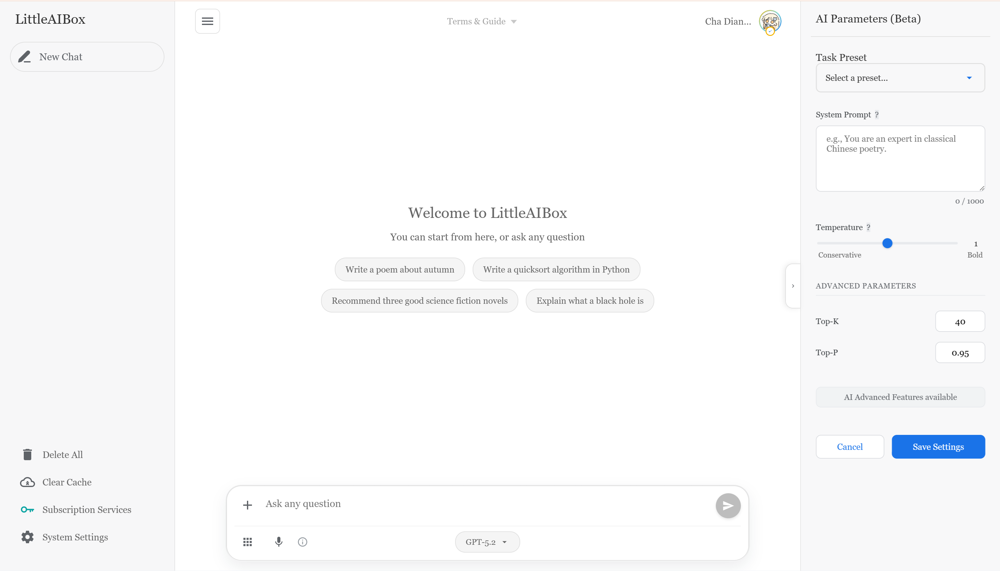
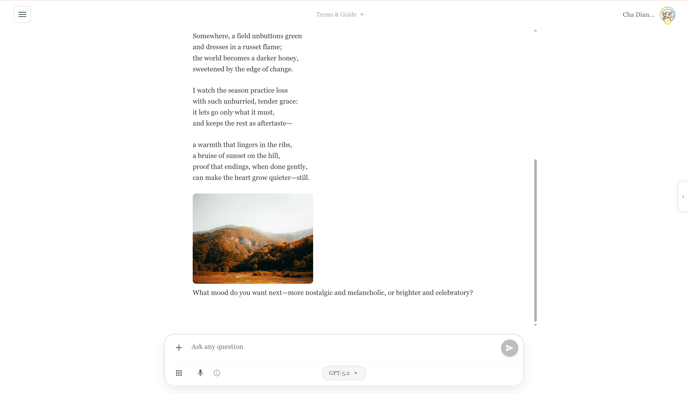
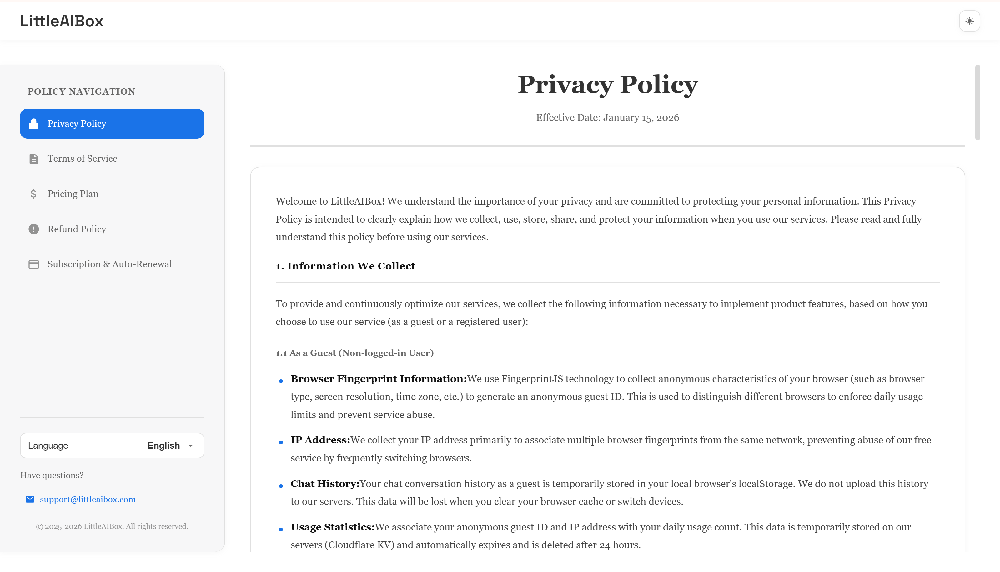

<div align="center">


# LittleAIBox

**A Modern, Cross-Platform AI Conversation Assistant**

[](https://opensource.org/licenses/MIT)
[](https://github.com/diandiancha/LittleAIBox)
[](https://github.com/diandiancha/LittleAIBox)
[](https://www.producthunt.com/products/littleaibox)

[中文](docs/README.zh-CN.md) | [English](README.md) | [日本語](docs/README.ja.md) | [한국어](docs/README.ko.md) | [Español](docs/README.es.md) | [Français](docs/README.fr.md)

LittleAIBox combines browser-side document processing, AI request orchestration and streamed rich-content rendering in a cross-platform application. Gemini is the original integration; the separately maintained service also supports additional model providers.

</div>

---

> 🎓 This project is developed for educational and research purposes.  

> 💼 Commercial deployments and premium services are operated separately by the author to ensure security and sustainability.

> **Reading this project:** the feature overview and backend architecture below explain the complete system. This repository publishes a frontend snapshot and selected core mechanisms; backend source, payment processing, production credentials and commercial entitlement rules are not included. Architectural descriptions do not imply that those services are bundled here.

---

## 🎯 Who Is This For?

LittleAIBox is perfect for:

- **Users in Restricted Regions**: Built-in service relay solutions to easily connect you with Gemini
- **Students & Researchers**: Analyze papers, presentations, and documents without leaving your browser
- **Developers**: Get coding help with file context, code explanations, and technical assistance
- **Content Creators**: Generate and edit markdown content with AI support
- **Privacy-Conscious Users**: Parse documents locally and understand which content is sent to a backend or model provider

---

### 🚀 Live Demo

<div align="center">

**Try it now:**  

[](https://littleaibox.com)

</div>

### 💡 Why LittleAIBox?

**What makes this project different?**

| Capability | Mechanism | Execution boundary |
|---------|-------------|--------|
| File Processing | 📄 PDF/Office readers, Worker and DOM paths | Browser; selected content can enter a model request |
| Rich Rendering | 📐 Markdown, KaTeX, Mermaid and Vega | Browser; asynchronous rendering coordinated with chat scrolling |
| Offline State | 📱 Service Worker and IndexedDB | Cached shell/local data; online inference remains service-backed |
| Cross-Platform | 🌐 Web, PWA and Capacitor adapters | Native behavior requires a generated platform project and device checks |
| Application Shell | ⚡ Vanilla JavaScript and Vite modules | Third-party libraries supply parsing and rendering capabilities |
| Model Integration | 🔌 Context assembly and provider protocol adaptation | Frontend requests plus a compatible backend |
| Failure Recovery | 🛡️ Key statistics, retry and circuit breaking | Separately maintained backend |
| Open Source | ✅ Selected frontend snapshot under MIT | Full-system architecture documented; backend implementation omitted |
| User Keys | 🔑 BYOK configuration | Provider and compatible-backend requirements still apply |

**Engineering focus**: inspectable browser processing, explicit service boundaries, streamed rich-content rendering and cross-platform interaction.

### 🌟 Official Description

> **Private, Global AI Chat & Integration Platform**
>
> LittleAIBox is a full-stack, cross-platform AI chat application built with Vite, Capacitor and Cloudflare. Its frontend handles local document processing and rich-content interaction; the service layer handles model integration, retrieval, sessions and failure recovery. Key features include:
>
> - Client-side parsing (PDF/DOCX/PPTX support)
> - Mermaid/LaTeX/Vega-Lite rendering with chart export
> - Real-time web search & Semantic Scholar research mode
> - Conversation timeline navigation
> - Dual API key management with intelligent load balancing
> - Customizable AI parameters and task presets
>
> The browser parses documents, stores local state and renders streamed responses. Selected message and attachment content is sent to the configured backend and model provider when a request is made; account and cloud features use their corresponding services. This separation keeps local document processing inspectable while the service layer manages model access, retries and synchronization.
>
> *[View on Product Hunt →](https://www.producthunt.com/products/littleaibox)*

### 📱 Application Screenshots

These screenshots illustrate earlier interface versions; individual controls may differ from the current public snapshot.

#### Main Page



#### Example Output Page



#### Privacy Page



---

## ✨ Key Features

### 🎯 **Smart File Processing**
- **Office Documents**: Parse Word (.docx), PDF, Excel (.xlsx, .xls, .csv), and **PowerPoint (.pptx)** files directly in the browser
- **Rich Media**: Support for images and Markdown files
- **Plain Text Files**: Support for various text file formats
- **File Viewer**: Built-in file viewer with syntax highlighting for code files, image preview, and rich text rendering
- **Local Parsing**: Extract document content in the browser; sending it to a model or cloud storage is a separate network operation
- **Parser Lifecycle**: Worker parsing where supported, main-thread fallback, progress reporting and progress-aware idle timeouts

### 🔐 **Privacy-First Design**
- **No Registration Required**: Start using immediately without creating an account
- **Multiple Login Options**: Email/password, OAuth (Google, GitHub), or guest mode
- **Multi-Factor Authentication (MFA)**: Optional TOTP authenticator app support with backup codes
- **Dual API Key Management**: Configure two API keys with intelligent mixed mode (load balancing) or single mode (backup fallback)
- **Self-Configure API Key**: Configure your own provider key through the compatible service's settings interface
- **Flexible Storage**: Registered users' API keys are persisted for multi-device sync; guest users' keys are stored locally only and automatically cleared on page refresh, ensuring privacy
- **Password Management**: Secure password reset via email verification
- **Custom Avatar**: Upload and manage your profile avatar

### 🌍 **Universal Access**
- **Service Routing**: Configurable relay integration; availability depends on backend, provider and network conditions
- **Offline State**: Cache the PWA shell and local data; model inference and search require online services
- **Cross-Platform**: Web/PWA interface and Capacitor adapters; native behavior needs device validation

### 💬 **Advanced Markdown Rendering**
- **Code Highlighting**: Bundled highlight.js support for common programming languages
- **Mathematical Expressions**: Beautiful math rendering with KaTeX
- **Diagrams**: Interactive Mermaid diagram support with PNG/SVG export
- **Data Visualization**: Vega-Lite chart rendering with interactive charts and PNG export
- **Mindmap Rendering**: Markmap-based mindmap rendering and preview for structured markdown content
- **Chart Export**: Download generated charts (Mermaid diagrams and Vega-Lite visualizations) as PNG or SVG files
- **GitHub Flavored Markdown**: Full GFM support with syntax highlighting
- **CJK Emphasis Compatibility**: Reuses the complete project's Marked extension for supported bold/italic boundaries next to CJK text and punctuation
- **Canvas Workbench**: Streamed artifact cards, source editing/copy and isolated previews for HTML, Markdown, SVG, React/Vue components, p5 and Markmap; desktop split view and a mobile drawer. Other language types provide source viewing/highlighting, not arbitrary-language execution. Generation requires a compatible backend using `context_mode: "canvas"` and `<canvasmode type="…" title="…">…</canvasmode>` responses.
- **Stream Pacing**: Reuses the complete project's pacer to adjust output to text arrivals and queue length for supported model families, with fallback typing for other models
- **Incremental Rich Content**: Reuses the complete project's DOM update and formula-state helpers to append content, retain reusable rendered nodes and restore matching formulas' horizontal scroll after region replacement

### 🛠️ **Advanced AI Features**
- **Multiple Interaction Modes**: 
  - **Search Mode**: Real-time web search integration for up-to-date information
  - **Research Mode**: Academic retrieval and source citations through a compatible service. The current complete service integrates Semantic Scholar and OpenAlex; this snapshot retains its existing research interface.
  - **Image Generation Mode**: AI-powered image creation
- **Custom AI Parameters**: Fine-tune AI behavior with:
  - System prompts for role customization
  - Temperature control (creativity vs. consistency)
  - Advanced parameters (topK, topP)
  - Task presets (coding assistant, writing assistant, translation, classical Chinese research, travel guide, roleplay creative)

### 🧾 **Productivity Export**
- **Multi-format Export**: Export chat/content to DOCX, PDF, PPTX, and XLSX
- **Content Preservation**: Keep headings, lists, code blocks, formulas, tables, diagrams, and images

### 🔗 **Bridge Session Collaboration**
- **Parent-Child Context Bridge**: Continue conversations with inherited context from source chats

### 📲 **Native Update Experience**
- **APK Update Check**: Detect newer APK versions and fallback to download page when needed

### 📌 **Open-Source Scope**
- **Frontend-Only Package**: This repository ships the open-source frontend; subscription/payment backends are omitted
- **Service-Backed Features**: Login, cloud sync, search and model replies require compatible services; a frontend control does not supply its backend
- **Snapshot Scope**: The Canvas frontend workbench is included; entertainment modules and the newer session/route integration remain outside this refresh

### 🌐 **Multi-Language Support**
- **7 Locale Catalogs**: Simplified Chinese, Traditional Chinese, English, Japanese, Korean, Spanish and French
- **Smart Detection**: Automatic language detection based on browser settings
- **Translation Caching**: Reuse loaded locale resources to reduce repeated requests

### 🎨 **Beautiful UI/UX**
- **Dark/Light Mode**: Seamless theme switching
- **Custom Fonts**: Choose from system default, serif, monospace, or elegant cursive fonts
- **Responsive Design**: Perfect on desktop, tablet, and mobile
- **Native Feel**: Capacitor integration for native mobile experience
- **Conversation Timeline**: Floating timeline navigation for quick access to assistant messages

### ⚡ **Performance Optimized**
- **Fast Loading**: Vite-powered build with code splitting
- **Smart Caching**: Service Worker with intelligent cache strategies
- **Lightweight**: Pure JavaScript (no heavy frameworks)

### 🛡️ **Enterprise-Grade Backend Architecture**
- **Elastic API Key Pool**: Production-grade multi-key rotation with automatic load balancing
- **Key Health & Circuit Breaker**: Track request success/failure statistics and isolate failed keys; this is not a continuous upstream probe or response-quality evaluator
- **Controlled Fallback**: Separate key selection, operating modes and failure recovery instead of treating them as a universal four-step pipeline
- **Failure Recovery**: Retry, circuit breaking and permitted fallback paths reduce transient failures; availability is not guaranteed

---

## 🏗️ Architecture

The diagram describes the complete application's frontend, service and infrastructure layers. Backend nodes explain the engineering design; their implementation and production configuration are maintained separately from this public checkout.

The expanded diagram groups the complete project's responsibilities: interaction/platform adapters, document processing, request orchestration, streaming, state synchronization, shared frontend/backend contracts, backend APIs, model reliability and background maintenance. Solid links show main request/data paths; dotted links show coordination, intermediate processing or lifecycle work. These are not separate deployments or steps every request executes.

Colors identify frontend, backend, shared contracts, storage/maintenance and external-provider responsibilities; pink marks extensions outside this refresh. The public snapshot synchronizes selected core mechanisms, not every current frontend module or its latest session/context implementation. Backend implementations and production configuration remain separate.

### 🏗️ System Diagram

```mermaid
flowchart TB
    %% The complete project is shown; the public frontend snapshot is partial.
    subgraph FRONTEND["Complete frontend: Web / PWA / Capacitor; public snapshot is partial"]
        direction TB
        subgraph INTERACTION["Interaction and platform adapters"]
            F_ENTRY["Application entry / routing / settings"]
            F_COMPOSER["Composer / attachments / mode selection"]
            F_KEYBOARD["Native and browser keyboard drivers"]
            F_VIEWPORT["Viewport sampling / scroll anchoring"]
            F_I18N["Locales / themes / resource loading"]
            F_NATIVE["Native bridge / files / sharing / updates"]
        end
        subgraph DOCUMENTS["Document and multimodal processing"]
            F_READERS["PDF / Office / text readers"]
            F_WORKERS["PDF / spreadsheet Workers and fallback"]
            F_IMAGES["Image blobs / hashes / CID references"]
            F_DOC_PLAN["Document intent / task routing / chunks"]
            F_DOC_PROCESS["Summary / retrieval / code structure"]
            F_VISION["Relevant image selection / visual review"]
        end
        subgraph ORCHESTRATION["Request and retrieval orchestration"]
            F_HISTORY["Conversation history / context budget"]
            F_RETRIEVAL["Search / research planning and evidence"]
            F_CONTEXT["Document / image / conversation context"]
            F_ASSEMBLER["Messages / model parameters / request IDs"]
            F_TRANSPORT["Request transport / cancellation / errors"]
        end
        subgraph PRESENTATION["Streaming and productivity"]
            F_STREAM["Response stream / pacing / incremental DOM"]
            F_CANVAS["Canvas: source / editing / isolated preview"]
            F_MARKDOWN["Markdown / highlighting / math protection"]
            F_CHARTS["KaTeX / Mermaid / Vega / mind maps"]
            F_IMAGE_VIEW["CID resolution / generated image layout"]
            F_EXPORT["Word / Excel / PPT / PDF export"]
            F_EXTENSIONS["Entertainment extensions: not synced"]
        end
        subgraph CLIENT_STATE["Conversation and local state"]
            F_CHAT["Conversations / turns / message identity"]
            F_SYNC["Save queue / sync state / remote changes"]
            F_CACHE["IndexedDB / cache policy / eviction"]
            F_PWA["Service Worker / PWA cache and updates"]
            F_BRIDGE["Parent-child conversation context bridge"]
        end
    end

    subgraph SHARED["Frontend/backend contracts: shared-runtime"]
        S_MODELS["Model metadata / request and context policy"]
        S_ATTACH["Image protocol / attachment hashes and persistence"]
        S_SYNC["Conversation / turn order and sync state"]
    end

    subgraph SERVICE["Cloudflare Pages Functions: backend source not included"]
        B_GATEWAY["Unified entry / version checks / routing"]
        B_SESSION["Sessions / visitor identity / access control"]
        B_AUTH["Email login / OAuth / MFA / password flows"]
        B_DATA["Conversation / turn / attachment / share APIs"]
        B_MODEL["Model requests / tools / streamed responses"]
        B_SEARCH["Web / image / academic retrieval"]
        B_RESOURCE["Image generation / resource proxying"]
        B_STORAGE["Message commits / titles / attachment lifecycle"]
    end

    subgraph MODEL_RELIABILITY["Model integration and reliability responsibilities"]
        M_ADAPTER["Model catalog / parameters / provider adapters"]
        M_KEYS["User keys / server pools / health statistics"]
        M_RETRY["Retry / circuit breaking / controlled fallback"]
        M_LIMITER["Rate limiter Worker / Durable Object"]
    end

    subgraph INFRASTRUCTURE["Storage and background maintenance"]
        D_DATABASE["D1: users / sessions / messages / settings"]
        D_OBJECTS["R2: document sources / images / avatars"]
        D_KV["KV: session state / cache / temporary state"]
        D_QUEUE["Cleanup queue / delayed retries"]
        D_CLEANUP["Cleanup consumer / referenced-resource checks"]
        D_CRON["Scheduled maintenance / retry scheduling"]
        D_DLQ["Dead-letter queue / manual investigation"]
    end

    subgraph EXTERNAL["External identity, data and model providers"]
        X_MODELS["Gemini / OpenAI-compatible / Claude services"]
        X_WEB["Brave web and image search"]
        X_ACADEMIC["Semantic Scholar / OpenAlex"]
        X_IMAGE["Image generation providers"]
        X_IDENTITY["Google / GitHub OAuth"]
        X_EMAIL["Email delivery service"]
    end

    S_MODELS -.-> F_HISTORY
    S_MODELS -.-> M_ADAPTER
    S_ATTACH -.-> F_IMAGES
    S_ATTACH -.-> B_STORAGE
    S_SYNC -.-> F_SYNC
    S_SYNC -.-> B_STORAGE

    %% Solid links: main data/request paths; dotted links: coordination or lifecycle work.
    F_ENTRY --> F_COMPOSER
    F_I18N -.-> F_ENTRY
    F_ENTRY -.-> F_EXTENSIONS
    F_NATIVE -.-> F_COMPOSER
    F_KEYBOARD --> F_VIEWPORT
    F_VIEWPORT -.-> F_ENTRY
    F_COMPOSER --> F_READERS
    F_READERS --> F_WORKERS
    F_READERS --> F_IMAGES
    F_READERS --> F_DOC_PLAN
    F_DOC_PLAN --> F_DOC_PROCESS
    F_IMAGES --> F_VISION
    F_DOC_PROCESS --> F_CONTEXT
    F_DOC_PROCESS -.-> F_TRANSPORT
    F_VISION -.-> F_TRANSPORT
    F_VISION --> F_CONTEXT
    F_COMPOSER --> F_CONTEXT
    F_HISTORY --> F_CONTEXT
    F_RETRIEVAL --> F_CONTEXT
    F_BRIDGE --> F_HISTORY
    F_CONTEXT --> F_ASSEMBLER --> F_TRANSPORT
    F_TRANSPORT --> B_GATEWAY
    F_RETRIEVAL --> B_GATEWAY
    B_MODEL --> F_STREAM
    F_STREAM --> F_MARKDOWN
    F_STREAM --> F_CANVAS
    F_CANVAS --> F_EXPORT
    F_MARKDOWN --> F_CHARTS
    F_STREAM --> F_IMAGE_VIEW
    F_CHARTS --> F_ENTRY
    F_IMAGE_VIEW --> F_ENTRY
    F_MARKDOWN --> F_EXPORT
    F_MARKDOWN -.-> F_EXTENSIONS
    F_STREAM --> F_CHAT
    F_CHAT --> F_HISTORY
    F_CHAT --> F_SYNC
    F_SYNC <--> F_CACHE
    F_IMAGES --> F_CACHE
    F_PWA -.-> F_ENTRY
    F_SYNC <--> B_GATEWAY
    B_GATEWAY --> B_SESSION
    B_GATEWAY --> B_AUTH
    B_SESSION --> B_DATA
    B_SESSION --> B_MODEL
    B_SESSION --> B_SEARCH
    B_SESSION --> B_RESOURCE
    B_AUTH --> X_IDENTITY
    B_AUTH --> X_EMAIL
    B_AUTH --> D_DATABASE
    B_SESSION --> D_KV
    B_DATA --> B_STORAGE
    B_STORAGE --> D_DATABASE
    B_STORAGE --> D_OBJECTS
    B_MODEL --> M_ADAPTER
    M_ADAPTER --> M_RETRY
    M_KEYS -.-> M_RETRY
    M_LIMITER -.-> B_MODEL
    M_RETRY --> X_MODELS
    B_SEARCH --> X_WEB
    B_SEARCH --> X_ACADEMIC
    B_RESOURCE --> X_IMAGE
    B_RESOURCE --> D_OBJECTS
    B_SEARCH -.-> D_KV
    B_STORAGE -.-> D_QUEUE
    D_CRON --> D_QUEUE
    D_QUEUE --> D_CLEANUP
    D_CLEANUP --> D_DATABASE
    D_CLEANUP --> D_OBJECTS
    D_CLEANUP -.-> D_DLQ

    classDef frontend fill:#e8f1ff,stroke:#5276a7,color:#172b4d
    classDef backend fill:#fff3dc,stroke:#ab7d32,color:#49330d
    classDef storage fill:#edf3ef,stroke:#63836c,color:#203e2b
    classDef external fill:#f0eafa,stroke:#8466a6,color:#39244f
    classDef shared fill:#eff3f7,stroke:#748598,color:#25384b
    classDef extension fill:#f7edf3,stroke:#ad6d91,color:#54243f
    class F_ENTRY,F_COMPOSER,F_KEYBOARD,F_VIEWPORT,F_I18N,F_NATIVE frontend
    class F_READERS,F_WORKERS,F_IMAGES,F_DOC_PLAN,F_DOC_PROCESS,F_VISION frontend
    class F_HISTORY,F_RETRIEVAL,F_CONTEXT,F_ASSEMBLER,F_TRANSPORT frontend
    class F_STREAM,F_CANVAS,F_MARKDOWN,F_CHARTS,F_IMAGE_VIEW,F_EXPORT frontend
    class F_CHAT,F_SYNC,F_CACHE,F_PWA,F_BRIDGE frontend
    class B_GATEWAY,B_SESSION,B_AUTH,B_DATA,B_MODEL,B_SEARCH,B_RESOURCE,B_STORAGE,M_ADAPTER,M_KEYS,M_RETRY,M_LIMITER backend
    class D_DATABASE,D_OBJECTS,D_KV,D_QUEUE,D_CLEANUP,D_CRON,D_DLQ storage
    class X_MODELS,X_WEB,X_ACADEMIC,X_IMAGE,X_IDENTITY,X_EMAIL external
    class F_EXTENSIONS extension
    class S_MODELS,S_ATTACH,S_SYNC shared
```



### 🧩 Frontend Stack

**Core Technologies**
- **Build Tool**: Vite 7.x
- **Framework**: Vanilla JavaScript (ES6+ Modules) - Zero framework overhead
- **Styling**: Tailwind CSS 4.x
- **Mobile**: Capacitor 7.x (Android support)

**Key Libraries**
- **Markdown**: marked.js + DOMPurify
- **Code Highlighting**: highlight.js
- **Math Rendering**: KaTeX
- **Charts**: Mermaid, Vega-Lite
- **File Parsing**: PDF.js, SheetJS/xlsx, JSZip/XML-based DOCX and PPTX readers, including Office math extraction
- **Storage**: IndexedDB + localStorage
- **Authentication**: Server-side sessions with OAuth 2.0 integration (Google, GitHub)
- **Security**: MFA/TOTP support with backup codes

### 💾 Client-Side Processing

All file parsing and processing happens entirely in the browser:
- **PPTX Parsing**: Extract supported slide text, tables, notes, images and Office math
- **PDF Reading**: Text and metadata extraction
- **Excel Processing**: Spreadsheet data parsing (.xlsx, .xls, .csv)
- **Word Documents**: Extract supported paragraphs, tables, images and Office math into text/Markdown
- **Image Handling**: Client-side image processing and base64 encoding

### Offline Support

- **Service Worker**: Custom caching strategies
- **IndexedDB**: Local chat history and settings storage
- **Progressive Web App**: Installable application shell and local state; model inference and search require online services

### 🔄 Core Execution Paths

**Message submission → model reply.** The browser collects text, direct images and parsed-document references, prepares conversation context and sends a request through the service interface. The service layer handles session validation, provider adaptation and upstream requests. The browser consumes the response stream, updates the message and completes rich-content rendering. The frontend interface is public; the model service is not bundled here.

**Document → usable context.** A reader checks the header and size. Spreadsheet and PDF readers use a Worker where supported, with main-thread fallback; DOCX/PPTX use DOM-based readers that periodically yield to the browser. Progress refreshes the idle deadline. Extracted text and images are separated: images use the existing local storage interface and content-hash/CID references. File-format resource guards are distinct from commercial quotas.

**Markdown → formulas and diagrams.** Formula preprocessing respects fenced and inline code. Math placeholders protect formulas during Markdown parsing, then the math renderer restores and renders them. Mermaid/Vega renderers load on demand, normalize supported input artifacts and apply shared theme settings. The existing chat entry coordinates asynchronous rendering and scroll position.

**Keyboard → viewport → reading position.** The controller selects a native or browser driver. Browser samples distinguish virtual-keyboard geometry, visual-viewport resizing and layout resizing; a keyboard session manages open/close state. Registered input surfaces receive geometry updates. The chat adapter preserves its bottom anchor or the user's reading position and releases listeners on cleanup.

**Local state → optional cloud sync.** IndexedDB/localStorage preserve frontend data, while the existing retry queue tracks pending service operations. Persistence, caches and remote synchronization have different lifecycles. This release retains the public snapshot's storage/sync interfaces instead of importing the commercial application's newer session system.

**Model failure → controlled recovery.** The complete service separates user-key selection, shared-key pooling, retry/circuit-breaker decisions and provider adaptation. The backend sections below explain those responsibilities without publishing credentials, production routing or commercial entitlement rules.

### 📦 Public Frontend Core Refresh

Version 3.1.0 updates selected Mermaid/Vega, math, document parser/Worker, keyboard and Canvas mechanisms in the existing public application. It retains the older conversation/storage integration; it does not claim complete source or feature parity with the separately maintained service.

### 🛡️ Backend Architecture

The project's backend is built on **Cloudflare Pages**, leveraging a modern serverless architecture. 

**Why is the backend closed-source?**

While I'm committed to transparency, the backend remains closed-source for several important reasons:

1. **Security**: Protecting user data, API keys, and authentication mechanisms
2. **Cost Control**: Preventing API key abuse and ensuring sustainable service costs
3. **Infrastructure**: Safeguarding proprietary optimization strategies and failover systems
4. **Compliance**: Meeting regional requirements while maintaining service quality

**What's transparent?**

- ✅ The published frontend snapshot is MIT licensed
- ✅ Frontend service call sites are inspectable
- ✅ You can inspect all network requests
- ✅ Client-side processing is fully auditable
- ✅ No hidden tracking or data collection

**For developers:** Frontend call sites show the service contracts expected by this snapshot. Self-hosting the complete system requires a compatible backend; this checkout does not provide backend source or promise a permanently stable public API.

#### Core Database Layer

**Cloudflare D1 (SQLite)**
- Complete user authentication system with multiple login methods:
  - Email/password with secure PBKDF2 hashing
  - OAuth 2.0 integration (Google, GitHub)
  - Guest mode for anonymous usage
- Multi-Factor Authentication (MFA) support:
  - TOTP authenticator app integration
  - Backup code generation and management
- Server-side session records support expiry, invalidation and multi-device login
- Password reset flow with email verification
- Chat history persistence with query and recovery support
- User configuration and preference management

#### Core: Elastic API Key Pool (APIKeyPool)

This system features a production-grade, highly available API key management system:

- **Multi-Key Rotation**: Intelligent management of multiple Gemini and Brave Search API keys with automatic load balancing
- **Health Statistics**: Estimate key health from request success/failure counts and track failure state
- **Automatic Failover**: Seamless switch to backup keys when a key fails or hits rate limits
- **Circuit Breaker Protection**: Prevents repeated requests to failed keys, protecting system resources
- **Intelligent Retry Strategy**: Exponential backoff algorithm to maximize request success rates

#### Core: Smart Failover & Degradation System

Key source selection, operating mode and final fallback have distinct responsibilities. The following concepts describe those choices rather than four steps every request executes:

1. **User Key Priority**: Prioritizes user-configured API keys
2. **Server Key Pool**: Select from configured shared keys when the service allows them
3. **Retry & Isolation**: Classify failures, apply retry policy and isolate failed keys
4. **Server Fallback**: A controlled final recovery path when the configured service permits it

The system classifies failures and attempts permitted recovery paths. Provider outages, unavailable credentials and network restrictions can still cause a request to fail.

#### Integrated Service Ecosystem

**Email Services**
- **Resend**: For secure email verification and password reset flows
- Supports HTML templates and internationalized email content
- Email-based account recovery and verification

**Search & Content**
- **Brave Search API**: High-quality web search results to enhance AI context understanding
- **Academic Sources**: Semantic Scholar and OpenAlex integration in the current complete service

**Image Generation**
- **Image Providers**: The complete service includes model-based generation and a Pollinations route; available routes depend on deployment
- Server-side generation/resource proxying; provider credentials are not included in the frontend repository

**Cloud Storage**
- **Cloudflare R2**: S3-compatible object storage for user avatars and attachments
- Global CDN acceleration with low-latency access
- **Cloudflare KV**: High-performance key-value storage for caching, session management, and usage limit tracking

---

## 📚 Documentation

<div align="center">

**Quick Navigation to Project Resources**

[](LEARN.md) 
[](CONTRIBUTING.md) 
[](.github/CODE_OF_CONDUCT.md) 
[](.github/SECURITY.md)

**📖 [Full Documentation Index](docs/)**

</div>

---

## 📁 Project Structure

```
LittleAIBox/
├── src/                         # Frontend source
│   ├── main.js                  # Main app entry
│   ├── api-config.js            # API/runtime config
│   ├── apk-update-manager.js    # Native APK update flow
│   ├── entitlements.js          # Plan/limit capability gating
│   ├── mindmap-mode.js          # Mindmap mode runtime
│   ├── stream-image-runtime.js  # Stream image handling
│   ├── stream-pacer.js         # Adaptive stream pacing copied from the complete project
│   ├── stream-text-update.js   # Incremental DOM update planning and commits
│   ├── sync-queue.js            # Offline retry/sync queue
│   ├── router.js                # Client-side routing
│   ├── sw-custom.js             # Service worker logic
│   ├── auth/                    # Auth modules (OAuth/MFA/UI)
│   ├── bridge/                  # Bridge session modules
│   ├── file-parsers/            # Upload/file parsing pipeline
│   ├── file-export/             # DOCX/PDF/PPTX/XLSX export
│   ├── rendering/               # Mermaid/Vega render adapters
│   ├── mathrender/              # Formula preprocessing and code-fence handling
│   ├── keyboard/                # Native/browser drivers and chat integration
│   ├── worker-parsers/          # Document parser Workers
│   └── floating-timeline/       # Timeline feature modules
├── public/                      # Static assets
│   ├── locales/                 # i18n dictionaries
│   ├── libs/                    # Browser-side third-party libs
│   ├── images/                  # Icons/images/pwa assets
│   ├── policy/                  # Policy/legal pages
│   ├── subscribe/               # Subscription placeholder pages
│   ├── promocode/               # Promo placeholder pages
│   ├── shared/                  # Shared web modules
│   ├── workers/                 # Web workers
│   ├── download-app/            # APK download landing page
│   └── downloads/               # APK file index
├── scripts/                     # Build/dev helper scripts
├── appshow/                     # Screenshot assets by language
├── docs/                        # Multi-language documentation
├── capacitor.config.json        # Mobile app config
├── vite.config.js               # Vite build config
├── tailwind.config.js           # Tailwind config
└── package.json                 # Dependencies/scripts
```

---

## 🚀 Getting Started

### 📝 Usage Note

**Usage Note**: The official service and this source checkout have different setup requirements. Model replies, authentication, search and cloud sync require a compatible backend. Entering a provider key alone does not supply these endpoints.

Get API Key: [Google AI Studio](https://aistudio.google.com/api-keys)

### Prerequisites

- Node.js 20.x at least 20.19, or 22.12+ (matching Vite's requirement)
- npm or yarn
- A Gemini API key (optional, but recommended for best experience)

> **Note**: Production shared keys and server implementations are not included. Local development no longer automatically forwards requests to the official production service.

### Installation

```bash
# Clone the repository
git clone https://github.com/diandiancha/LittleAIBox.git
cd LittleAIBox

# Install dependencies
npm install

# Start development server
npm run dev

# Build for production
npm run build
```

### Configuration

**Local source checkout:** copy `.env.example` to `.env.local`, set `VITE_API_BASE_URL` to your compatible backend's HTTP(S) origin, and restart Vite. Leave it empty for same-origin requests. Use an origin without a path, credentials, query or fragment. `VITE_*` values are public and must never contain secrets. A generic OpenAI-compatible model endpoint alone does not implement the authentication, attachment and conversation-storage APIs.

The following account/key steps describe the official service or a compatible deployment:

1. **Get Your API Key** (if you don't have one):
   - Visit [Google AI Studio](https://aistudio.google.com/api-keys)
   - Create a new API key
   - Copy the key for use in the app

2. **Configure in App**:
   - Open the app: [LittleAIBox](https://littleaibox.com)
   - Go to Settings
   - Enter your Gemini API key
   - Save and start chatting!

3. **Account Options** (Optional):
   - **Create Account**: Register with email/password or use OAuth (Google/GitHub)
   - **Enable MFA**: Go to Settings → Security to set up TOTP authenticator
   - **Guest Mode**: Use without registration (API keys stored locally only)

### Troubleshooting

**Common Issues:**

| Issue | Solution |
|-------|----------|
| API Key not working | Ensure your key is from Google AI Studio and has quota remaining |
| Files not parsing | Check browser console for errors; ensure file format is supported |
| Slow responses | Check your network connection; consider using your own API key |
| Mobile build fails | Ensure Android Studio is installed and environment is set up correctly |

**Need Help?**
- Check [Issues](https://github.com/diandiancha/LittleAIBox/issues) for known problems
- Open a new issue with your problem details

### Building for Mobile

First build the web assets with `npm run build`. The Android platform project and release signing material are not included; generate your own platform project and use your own application identity/signing configuration. Native behavior needs device testing.

```bash
# Add Android platform
npx cap add android

# Sync files
npx cap sync

# Open in Android Studio
npx cap open android
```

---

## 🎯 Use Cases

- **Academic Research**: Parse and analyze research papers, presentations
- **Content Creation**: Generate and edit markdown content with AI
- **Code Assistance**: Get help with programming tasks and code explanations
- **Document Analysis**: Extract insights from Office documents
- **Learning Tool**: Interactive AI tutoring with file attachments

---

## 🤝 Contributing

I welcome contributions! Whether you're fixing bugs, adding features, or improving documentation, every contribution makes LittleAIBox better.

### How to Contribute

1. **Fork the repository** and clone it locally
2. **Create a branch**: `git checkout -b feature/your-feature-name`
3. **Make your changes** and test them thoroughly
4. **Commit your changes**: `git commit -m "Add: description of your changes"`
5. **Push to your fork**: `git push origin feature/your-feature-name`
6. **Open a Pull Request** with a clear description of your changes

### Guidelines

- Follow existing code style and conventions
- Add comments for complex logic
- Update documentation for new features
- Write clear commit messages
- Test your changes before submitting

### Roadmap

Potential contribution directions, subject to discussion and without a delivery commitment:

- 🌐 iOS support (Capacitor)
- 📊 More file format support
- 🎨 Custom themes
- 🔌 Plugin system
- 🌍 More languages
- 📱 Enhanced mobile features

Have ideas? [Open an issue](https://github.com/diandiancha/LittleAIBox/issues) or start a discussion!

---

## 🔒 Privacy & Security

- **Client-Side Processing**: File parsing happens in your browser
- **Local Storage**: Chat history stored locally (optional cloud sync)
- **Secure Authentication**: 
  - Multiple login options (email/password, OAuth)
  - Optional MFA/TOTP for enhanced security
  - Secure password reset via email verification
- **No Tracking**: Privacy-first design
- **Open Source**: The published frontend is inspectable; backend source is maintained separately
- **API Key Handling**: Provider keys are sensitive configuration; never embed them in public build variables or commit them

🧠 **Local parsing, model requests and optional cloud sync are separate operations. Sending messages or using cloud features can transmit content to the configured service and provider; local parsing does not mean offline inference.**

---

## 📄 License

This project is licensed under the [MIT License](LICENSE).

Copyright (c) 2025 diandiancha

---

<div align="center">

Made with ❤️ by diandiancha

**Star ⭐ this repo if you find it helpful!**

💬 **Questions or feedback? [Open an issue](https://github.com/diandiancha/LittleAIBox/issues) — I read every one of them!**

</div>
