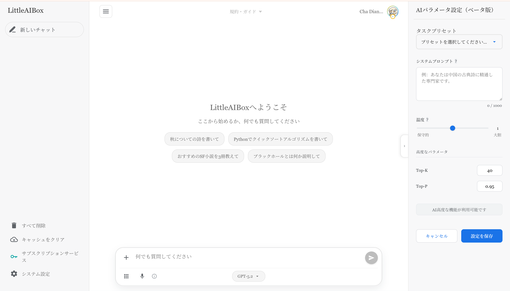
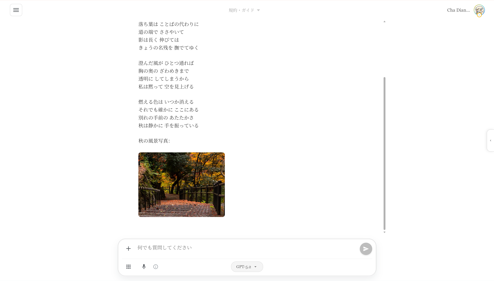
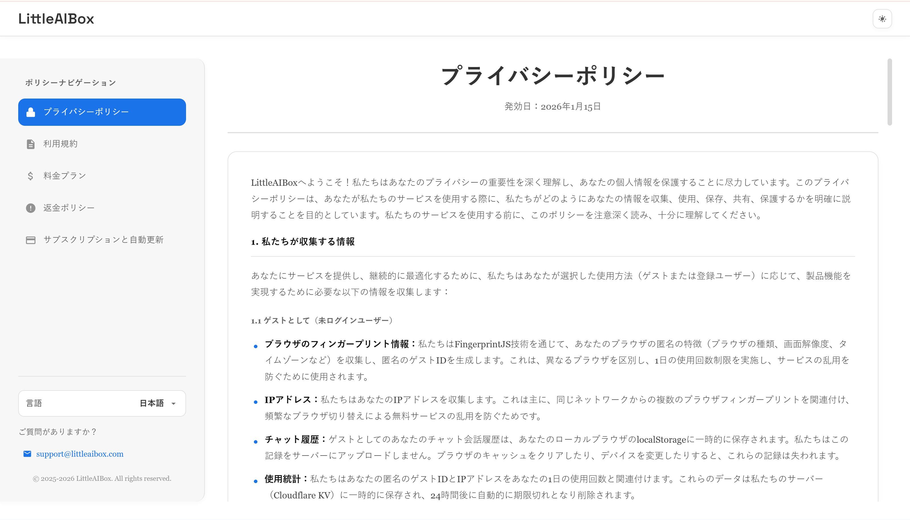

<div align="center">


# LittleAIBox

**モダンなクロスプラットフォーム AI 会話アシスタント**

[](https://opensource.org/licenses/MIT)
[](https://github.com/diandiancha/LittleAIBox)
[](https://github.com/diandiancha/LittleAIBox)
[](https://www.producthunt.com/products/littleaibox)

[中文](README.zh-CN.md) | [English](../README.md) | [日本語](README.ja.md) | [한국어](README.ko.md) | [Español](README.es.md) | [Français](README.fr.md)

このプロジェクトは、インテリジェントな AI 体験を提供するため、**Google Gemini API** を使用して会話機能を構築しています。

</div>

> **公開範囲と更新:** この文書はプロジェクト全体の機能と設計を説明します。公開リポジトリは選択したフロントエンドのスナップショットで、バックエンド、決済、商用の権限規則、認証情報は含みません。3.1.0 では図表・数式、文書解析 Worker、キーボード処理を更新します。ローカル解析とモデルへの送信は別の操作です。最新の実行条件と仕組みは [English README](../README.md) を参照してください。

---

> 🎓 このプロジェクトは教育および研究目的で開発されています。

> 💼 商用展開とプレミアムサービスは、セキュリティと持続可能性を確保するため、作者が別途運営しています。

---

## 🎯 このプロジェクトの対象者

LittleAIBox は以下の方に最適です：

- **制限地域のユーザー**: Gemini との接続を簡単にする組み込みサービスリレーソリューション
- **学生と研究者**: ブラウザを離れることなく、論文、プレゼンテーション、文書を分析
- **開発者**: ファイルコンテキスト、コード説明、技術支援によるコーディングヘルプ
- **コンテンツクリエーター**: AI サポートによる Markdown コンテンツの生成と編集
- **プライバシー重視ユーザー**: すべての処理がローカルで実行され、データを完全にコントロール

---

### 🚀 ライブデモ

<div align="center">

**今すぐ試す:**  

[](https://littleaibox.com)

</div>

### 💡 なぜ LittleAIBox を選ぶ？

**このプロジェクトの独自性：**

| 機能 | LittleAIBox | その他 |
|------|-------------|--------|
| ファイル処理 | 📄 PPTX、DOCX、PDF、XLSX サポート | 限定的またはサーバー側のみ |
| プライバシー | 🔒 クライアント側処理、アップロード不要 | しばしばファイルアップロードが必要 |
| オフラインサポート | 📱 完全な PWA、オフラインで動作 | 限られたオフライン機能 |
| クロスプラットフォーム | 🌐 Web + PWA + Android ネイティブ | 通常 Web またはモバイルのみ |
| フレームワーク | ⚡ Vanilla JS、ゼロ肥大化 | しばしば React/Vue の依存関係 |
| 地域アクセス | 🌍 組み込みサービスリレーソリューション | 地域的に制限される可能性 |
| **高可用性** | 🛡️ **エンタープライズグレードの API プール**、ヘルスチェックと自動フェイルオーバー | ❌ 単一 API 依存、障害に弱い |
| オープンソース | ✅ 100% フロントエンドオープンソース | 様々 |
| コスト | 💰 独自の API キーを使用 | しばしばサブスクリプションベース |

**LittleAIBox を選択する理由**: 最大限のプライバシー、オフラインファースト設計、ゼロフレームワーク依存、AI 会話の完全なコントロール。

### 🌟 公式説明

> **プライベートでグローバルな AI チャット＆統合プラットフォーム**
>
> LittleAIBox は、全スタック、クロスプラットフォームの Gemini AI チャットアプリケーション（Vite/Capacitor/Cloudflare ベース）です。バックエンドには、地域制限をバイパスし、安定したグローバルアクセスを保証するインテリジェントな API プーリングおよびプロキシ機能を備えています。主な機能：
>
> - クライアント側パース（PDF/DOCX/PPTX サポート）
> - Mermaid/LaTeX/Vega-Lite レンダリング、チャートエクスポート対応
> - リアルタイム Web 検索と Semantic Scholar 研究モード
> - 会話タイムラインナビゲーション
> - デュアル API キー管理、インテリジェントロードバランシング
> - カスタマイズ可能な AI パラメータとタスクプリセット
>
> 文書の解析と表示はブラウザー内で行います。メッセージ送信やクラウド機能では、選択した内容が設定したサービスやモデル提供者へ送られます。ローカル解析はオフライン推論を意味しません。
>
> *[Product Hunt で見る →](https://www.producthunt.com/products/littleaibox)*

### 📱 アプリケーションスクリーンショット

#### メインページ



#### サンプルページ



#### プライバシーページ



---

## ✨ 主な機能

### 🎯 **スマートファイル処理**
- **Office ドキュメント**: Word (.docx)、PDF、Excel (.xlsx, .xls, .csv)、**PowerPoint (.pptx)** ファイルをブラウザ内で直接解析
- **リッチメディア**: 画像と Markdown ファイルをサポート
- **プレーンテキストファイル**: 様々なテキストファイル形式をサポート
- **ファイルビューア**: コードファイルのシンタックスハイライト、画像プレビュー、リッチテキストレンダリングを備えた組み込みファイルビューア
- **アップロード不要**: すべてのファイル処理がクライアント側で実行され、プライバシーを最大限に保護

### 🔐 **プライバシーファーストデザイン**
- **登録不要**: アカウントを作成せずにすぐに使用開始
- **複数のログインオプション**: メール/パスワード、OAuth（Google、GitHub）、またはゲストモード
- **多要素認証 (MFA)**: オプションの TOTP 認証アプリサポート、バックアップコード付き
- **デュアル API キー管理**: 2つの API キーを設定し、インテリジェント混合モード（ロードバランシング）またはシングルモード（バックアップ切り替え）をサポート
- **自己設定 API キー**: 独自の Gemini API キーを使用し、データを完全にコントロール
- **柔軟なストレージ**: 登録ユーザーの API キーは永続化され、マルチデバイス同期に対応；ゲストユーザーのキーはローカルのみに保存され、ページ更新時に自動的にクリアされ、プライバシーを完全に保護します
- **パスワード管理**: メール検証による安全なパスワードリセット
- **カスタムアバター**: プロフィールアバターのアップロードと管理

### 🌍 **ユニバーサルアクセス**
- **地域制限の解決**: 地理的制限を回避する組み込みサービスリレールーティング
- **オフラインファースト**: オフライン機能を備えた完全な PWA サポート
- **クロスプラットフォーム**: Web、PWA、Android ネイティブアプリでシームレスに動作

### 💬 **高度な Markdown レンダリング**
- **コードハイライト**: 40+ のプログラミング言語をサポート
- **数式**: KaTeX による美しい数式レンダリング
- **図表**: インタラクティブな Mermaid 図表サポート、PNG/SVG エクスポート対応
- **データ可視化**: Vega-Lite チャートレンダリング、インタラクティブチャートと PNG エクスポート
- **Mindmap レンダリング**: Markmap ベースのマインドマップ表示とプレビュー
- **チャートエクスポート**: 生成されたチャート（Mermaid 図表と Vega-Lite 可視化）を PNG または SVG ファイルとしてダウンロード可能
- **GitHub フレーバー**: シンタックスハイライト付きの完全な GFM サポート

### 🛠️ **高度な AI 機能**
- **複数のインタラクションモード**：
  - **検索モード**: 最新情報を取得するリアルタイム Web 検索統合
  - **研究モード**: Semantic Scholar API による学術研究 - 関連する学術論文を自動検索・引用し、構造化された回答（要約/序論/方法/結果/議論/結論）を提供し、本文引用 [1], [2]... を提供
  - **画像生成モード**: AI 駆動の画像生成
- **カスタム AI パラメータ**: AI の動作を細かく調整：
  - 役割カスタマイズのためのシステムプロンプト
  - 温度制御（創造性 vs 一貫性）
  - 高度なパラメータ（topK、topP）
  - タスクプリセット（コーディングアシスタント、ライティングアシスタント、翻訳、古典中国語研究、旅行ガイド、ロールプレイ創作）

### 🧾 **生産性エクスポート**
- **多形式エクスポート**: DOCX / PDF / PPTX / XLSX へのエクスポートに対応
- **構造保持**: 見出し・リスト・コード・数式・表・図・画像の構造を保持

### 🔗 **Bridge セッション連携**
- **親子コンテキスト継承**: 元会話の文脈を引き継いで会話を継続可能

### 📲 **ネイティブ更新体験**
- **APK 更新検知**: 新バージョン検知とダウンロードページへのフォールバックに対応

### 📌 **オープンソース公開範囲**
- **フロントエンド公開**: 本リポジトリはフロントエンド実装のみ公開（購読/課金バックエンドは非同梱）

### 🌐 **多言語サポート**
- **6 言語**: 中国語（簡体字/繁体字）、英語、日本語、韓国語、スペイン語、フランス語
- **スマート検出**: ブラウザ設定に基づく自動言語検出
- **最適化された読み込み**: 即座の言語切り替えのためのインテリジェントな翻訳キャッシュ

### 🎨 **美しい UI/UX**
- **ダーク/ライトモード**: シームレスなテーマ切り替え
- **カスタムフォント**: システムデフォルト、セリフ、等幅、またはエレガントな筆記体フォントから選択可能
- **レスポンシブデザイン**: デスクトップ、タブレット、モバイルで完璧に動作
- **ネイティブ感**: Capacitor 統合により、ネイティブモバイル体験を実現
- **会話タイムライン**: アシスタントメッセージへのクイックアクセスのためのフローティングタイムラインナビゲーション

### ⚡ **パフォーマンス最適化**
- **高速読み込み**: コード分割を備えた Vite パワービルド
- **スマートキャッシュ**: インテリジェントなキャッシュ戦略を持つ Service Worker
- **軽量**: 純粋な JavaScript（重いフレームワークなし）

### 🛡️ **エンタープライズグレードのバックエンドアーキテクチャ**
- **エラスティック API キープール**: 本番グレードのマルチキー回転と自動ロードバランシング
- **ヘルスチェックとサーキットブレーカー**: リアルタイム監視とインテリジェントなフェイルオーバー保護
- **4層インテリジェント劣化**: 障害下でもシームレスなサービス継続性
- **高可用性**: 自動地域制限バイパス、サービスが中断しない

---

## 🏗️ アーキテクチャ

### 🏗️ システムアーキテクチャ図

```mermaid
flowchart TB
    %% The complete project is shown; the public frontend snapshot is partial.
    subgraph FRONTEND["Complete frontend: Web / PWA / Capacitor; public snapshot is partial"]
        direction TB
        subgraph INTERACTION["Interaction and platform adapters"]
            F_ENTRY["Application entry / routing / settings"]
            F_COMPOSER["Composer / attachments / mode selection"]
            F_KEYBOARD["Native and browser keyboard drivers"]
            F_VIEWPORT["Viewport sampling / scroll anchoring"]
            F_I18N["Locales / themes / resource loading"]
            F_NATIVE["Native bridge / files / sharing / updates"]
        end
        subgraph DOCUMENTS["Document and multimodal processing"]
            F_READERS["PDF / Office / text readers"]
            F_WORKERS["PDF / spreadsheet Workers and fallback"]
            F_IMAGES["Image blobs / hashes / CID references"]
            F_DOC_PLAN["Document intent / task routing / chunks"]
            F_DOC_PROCESS["Summary / retrieval / code structure"]
            F_VISION["Relevant image selection / visual review"]
        end
        subgraph ORCHESTRATION["Request and retrieval orchestration"]
            F_HISTORY["Conversation history / context budget"]
            F_RETRIEVAL["Search / research planning and evidence"]
            F_CONTEXT["Document / image / conversation context"]
            F_ASSEMBLER["Messages / model parameters / request IDs"]
            F_TRANSPORT["Request transport / cancellation / errors"]
        end
        subgraph PRESENTATION["Streaming and productivity"]
            F_STREAM["Response stream / pacing / incremental DOM"]
            F_MARKDOWN["Markdown / highlighting / math protection"]
            F_CHARTS["KaTeX / Mermaid / Vega / mind maps"]
            F_IMAGE_VIEW["CID resolution / generated image layout"]
            F_EXPORT["Word / Excel / PPT / PDF export"]
            F_EXTENSIONS["Canvas / entertainment modules: not synced"]
        end
        subgraph CLIENT_STATE["Conversation and local state"]
            F_CHAT["Conversations / turns / message identity"]
            F_SYNC["Save queue / sync state / remote changes"]
            F_CACHE["IndexedDB / cache policy / eviction"]
            F_PWA["Service Worker / PWA cache and updates"]
            F_BRIDGE["Parent-child conversation context bridge"]
        end
    end

    subgraph SHARED["Frontend/backend contracts: shared-runtime"]
        S_MODELS["Model metadata / request and context policy"]
        S_ATTACH["Image protocol / attachment hashes and persistence"]
        S_SYNC["Conversation / turn order and sync state"]
    end

    subgraph SERVICE["Cloudflare Pages Functions: backend source not included"]
        B_GATEWAY["Unified entry / version checks / routing"]
        B_SESSION["Sessions / visitor identity / access control"]
        B_AUTH["Email login / OAuth / MFA / password flows"]
        B_DATA["Conversation / turn / attachment / share APIs"]
        B_MODEL["Model requests / tools / streamed responses"]
        B_SEARCH["Web / image / academic retrieval"]
        B_RESOURCE["Image generation / resource proxying"]
        B_STORAGE["Message commits / titles / attachment lifecycle"]
    end

    subgraph MODEL_RELIABILITY["Model integration and reliability responsibilities"]
        M_ADAPTER["Model catalog / parameters / provider adapters"]
        M_KEYS["User keys / server pools / health statistics"]
        M_RETRY["Retry / circuit breaking / controlled fallback"]
        M_LIMITER["Rate limiter Worker / Durable Object"]
    end

    subgraph INFRASTRUCTURE["Storage and background maintenance"]
        D_DATABASE["D1: users / sessions / messages / settings"]
        D_OBJECTS["R2: document sources / images / avatars"]
        D_KV["KV: session state / cache / temporary state"]
        D_QUEUE["Cleanup queue / delayed retries"]
        D_CLEANUP["Cleanup consumer / referenced-resource checks"]
        D_CRON["Scheduled maintenance / retry scheduling"]
        D_DLQ["Dead-letter queue / manual investigation"]
    end

    subgraph EXTERNAL["External identity, data and model providers"]
        X_MODELS["Gemini / OpenAI-compatible / Claude services"]
        X_WEB["Brave web and image search"]
        X_ACADEMIC["Semantic Scholar / OpenAlex"]
        X_IMAGE["Image generation providers"]
        X_IDENTITY["Google / GitHub OAuth"]
        X_EMAIL["Email delivery service"]
    end

    S_MODELS -.-> F_HISTORY
    S_MODELS -.-> M_ADAPTER
    S_ATTACH -.-> F_IMAGES
    S_ATTACH -.-> B_STORAGE
    S_SYNC -.-> F_SYNC
    S_SYNC -.-> B_STORAGE

    %% Solid links: main data/request paths; dotted links: coordination or lifecycle work.
    F_ENTRY --> F_COMPOSER
    F_I18N -.-> F_ENTRY
    F_ENTRY -.-> F_EXTENSIONS
    F_NATIVE -.-> F_COMPOSER
    F_KEYBOARD --> F_VIEWPORT
    F_VIEWPORT -.-> F_ENTRY
    F_COMPOSER --> F_READERS
    F_READERS --> F_WORKERS
    F_READERS --> F_IMAGES
    F_READERS --> F_DOC_PLAN
    F_DOC_PLAN --> F_DOC_PROCESS
    F_IMAGES --> F_VISION
    F_DOC_PROCESS --> F_CONTEXT
    F_DOC_PROCESS -.-> F_TRANSPORT
    F_VISION -.-> F_TRANSPORT
    F_VISION --> F_CONTEXT
    F_COMPOSER --> F_CONTEXT
    F_HISTORY --> F_CONTEXT
    F_RETRIEVAL --> F_CONTEXT
    F_BRIDGE --> F_HISTORY
    F_CONTEXT --> F_ASSEMBLER --> F_TRANSPORT
    F_TRANSPORT --> B_GATEWAY
    F_RETRIEVAL --> B_GATEWAY
    B_MODEL --> F_STREAM
    F_STREAM --> F_MARKDOWN
    F_MARKDOWN --> F_CHARTS
    F_STREAM --> F_IMAGE_VIEW
    F_CHARTS --> F_ENTRY
    F_IMAGE_VIEW --> F_ENTRY
    F_MARKDOWN --> F_EXPORT
    F_MARKDOWN -.-> F_EXTENSIONS
    F_STREAM --> F_CHAT
    F_CHAT --> F_HISTORY
    F_CHAT --> F_SYNC
    F_SYNC <--> F_CACHE
    F_IMAGES --> F_CACHE
    F_PWA -.-> F_ENTRY
    F_SYNC <--> B_GATEWAY
    B_GATEWAY --> B_SESSION
    B_GATEWAY --> B_AUTH
    B_SESSION --> B_DATA
    B_SESSION --> B_MODEL
    B_SESSION --> B_SEARCH
    B_SESSION --> B_RESOURCE
    B_AUTH --> X_IDENTITY
    B_AUTH --> X_EMAIL
    B_AUTH --> D_DATABASE
    B_SESSION --> D_KV
    B_DATA --> B_STORAGE
    B_STORAGE --> D_DATABASE
    B_STORAGE --> D_OBJECTS
    B_MODEL --> M_ADAPTER
    M_ADAPTER --> M_RETRY
    M_KEYS -.-> M_RETRY
    M_LIMITER -.-> B_MODEL
    M_RETRY --> X_MODELS
    B_SEARCH --> X_WEB
    B_SEARCH --> X_ACADEMIC
    B_RESOURCE --> X_IMAGE
    B_RESOURCE --> D_OBJECTS
    B_SEARCH -.-> D_KV
    B_STORAGE -.-> D_QUEUE
    D_CRON --> D_QUEUE
    D_QUEUE --> D_CLEANUP
    D_CLEANUP --> D_DATABASE
    D_CLEANUP --> D_OBJECTS
    D_CLEANUP -.-> D_DLQ

    classDef frontend fill:#e8f1ff,stroke:#5276a7,color:#172b4d
    classDef backend fill:#fff3dc,stroke:#ab7d32,color:#49330d
    classDef storage fill:#edf3ef,stroke:#63836c,color:#203e2b
    classDef external fill:#f0eafa,stroke:#8466a6,color:#39244f
    classDef shared fill:#eff3f7,stroke:#748598,color:#25384b
    classDef extension fill:#f7edf3,stroke:#ad6d91,color:#54243f
    class F_ENTRY,F_COMPOSER,F_KEYBOARD,F_VIEWPORT,F_I18N,F_NATIVE frontend
    class F_READERS,F_WORKERS,F_IMAGES,F_DOC_PLAN,F_DOC_PROCESS,F_VISION frontend
    class F_HISTORY,F_RETRIEVAL,F_CONTEXT,F_ASSEMBLER,F_TRANSPORT frontend
    class F_STREAM,F_MARKDOWN,F_CHARTS,F_IMAGE_VIEW,F_EXPORT frontend
    class F_CHAT,F_SYNC,F_CACHE,F_PWA,F_BRIDGE frontend
    class B_GATEWAY,B_SESSION,B_AUTH,B_DATA,B_MODEL,B_SEARCH,B_RESOURCE,B_STORAGE,M_ADAPTER,M_KEYS,M_RETRY,M_LIMITER backend
    class D_DATABASE,D_OBJECTS,D_KV,D_QUEUE,D_CLEANUP,D_CRON,D_DLQ storage
    class X_MODELS,X_WEB,X_ACADEMIC,X_IMAGE,X_IDENTITY,X_EMAIL external
    class F_EXTENSIONS extension
    class S_MODELS,S_ATTACH,S_SYNC shared
```



### 🧩 フロントエンドスタック

**コア技術**
- **ビルドツール**: Vite 7.x
- **フレームワーク**: バニラ JavaScript (ES6+ Modules) - フレームワークオーバーヘッドゼロ
- **スタイリング**: Tailwind CSS 4.x
- **モバイル**: Capacitor 7.x (Android サポート)

**主要ライブラリ**
- **Markdown**: marked.js + DOMPurify
- **コードハイライト**: highlight.js (40+ 言語)
- **数式レンダリング**: KaTeX
- **チャート**: Mermaid、Vega-Lite
- **ファイル解析**: mammoth (Word)、PDF.js、xlsx、pptx2html
- **ストレージ**: IndexedDB + localStorage
- **認証**: サーバー側セッションと OAuth 2.0（Google、GitHub）
- **セキュリティ**: MFA/TOTP サポート、バックアップコード付き

### 💾 クライアント側処理

すべてのファイル解析と処理は完全にブラウザ内で実行されます：
- **PPTX パース**: PowerPoint コンテンツの完全抽出
- **PDF 読み取り**: テキストとメタデータの抽出
- **Excel 処理**: スプレッドシートデータの解析 (.xlsx, .xls, .csv)
- **Word ドキュメント**: フォーマット保持付き DOCX ファイル解析
- **画像処理**: クライアント側画像処理と base64 エンコーディング

### オフラインサポート

- **Service Worker**: カスタムキャッシュ戦略
- **IndexedDB**: ローカルチャット履歴と設定ストレージ
- **プログレッシブ Web アプリ**: インストール可能でオフラインで動作

### 🛡️ バックエンドアーキテクチャ

本プロジェクトのバックエンドは **Cloudflare Pages** 上に構築され、モダンなサーバーレスアーキテクチャを採用しています。

**なぜバックエンドはクローズドソースなのか？**

透明性に取り組んでいますが、バックエンドは以下の重要な理由によりクローズドソースとして維持されています：

1. **セキュリティ**: ユーザーデータ、API キー、認証メカニズムの保護
2. **コスト管理**: API キーの不正使用を防ぎ、持続可能なサービスコストを確保
3. **インフラストラクチャ**: 独自の最適化戦略とフェイルオーバーシステムの保護
4. **コンプライアンス**: 地域要件を満たしながらサービス品質を維持

**何が透明か？**

- ✅ すべてのフロントエンドコードはオープンソースで MIT ライセンス
- ✅ すべての API エンドポイントは公開され、よく文書化されています
- ✅ すべてのネットワークリクエストを検査できます
- ✅ クライアント側処理は完全に監査可能
- ✅ 隠れた追跡やデータ収集なし

**開発者向け**: フロントエンドコードはすべてのバックエンド相互作用を示しており、独自のバックエンドを構築するか、同じ API を使用してスタック全体を自己ホストできます。すべての API は公開され、安定しています。

#### コアデータベース層

**Cloudflare D1 (SQLite)**
- 完全なユーザー認証システム、複数のログイン方法をサポート：
  - 安全な PBKDF2 ハッシュを使用したメール/パスワード
  - OAuth 2.0 統合（Google、GitHub）
  - 匿名使用のためのゲストモード
- 多要素認証 (MFA) サポート：
  - TOTP 認証アプリ統合
  - バックアップコードの生成と管理
- サーバー側のセッション記録で有効期限、無効化、複数デバイスを管理
- メール検証によるパスワードリセットフロー
- チャット履歴の永続化ストレージ、履歴のクエリと復元をサポート
- ユーザー設定と環境設定の管理

#### コア：弾性 API キープール (APIKeyPool)

このシステムには、プロダクションレベルの高可用 API キー管理システムが搭載されています：

- **マルチキーローテーション**: 複数の Gemini と Brave Search API キーをインテリジェントに管理し、自動ロードバランシングを実現
- **ヘルスチェックメカニズム**: 各キーの可用性と応答品質をリアルタイムで監視
- **自動フェイルオーバー**: キーが失敗またはレート制限に達した場合、バックアップキーにシームレスに切り替え
- **サーキットブレーカー保護**: 短時間内の失敗したキーへの繰り返しリクエストを防止し、システムリソースを保護
- **インテリジェントリトライ戦略**: 指数バックオフアルゴリズムにより、リクエスト成功率を最大化

#### コア：インテリジェントデグレードとフォールバックシステム (Smart Failover)

慎重に設計された4層のインテリジェントデグレードアーキテクチャを実装し、高可用性とサービス継続性を確保：

1. **ユーザーキー優先**: ユーザーが設定した API キーを優先的に使用
2. **ハイブリッドモード**: ユーザーキーをベースに、サーバーキーをインテリジェントに補完
3. **シングルキーモード**: 単一のサーバーキーをバックアップソリューションとして使用
4. **サーバーフォールバック**: 最終的な保障メカニズムにより、サービスが永続的に中断されることを防止

このシステムは、地域制限、無効なキー、ネットワーク障害などの問題を自動的に検出し、バイパスして、ユーザーに継続的で安定したサービス体験を提供します。

#### 統合サービスエコシステム

**メールサービス**
- **Resend**: 安全なメール検証とパスワードリセットフローに使用
- HTML テンプレートと国際化メールコンテンツをサポート
- メールベースのアカウント回復と検証

**検索とコンテンツ**
- **Brave Search API**: 高品質な Web 検索結果を提供し、AI コンテキスト理解を強化
- **学術情報源**: 完全なサービスでは Semantic Scholar と OpenAlex を統合

**画像生成**
- **pollinations.ai**: 複数のアーティスティックスタイルをサポートする高性能画像生成サービス
- ユーザープライバシーを保護するクライアント側プロキシサービス

**クラウドストレージ**
- **Cloudflare R2**: ユーザーアバターと添付ファイルのストレージ用 S3 互換オブジェクトストレージ
- グローバル CDN アクセラレーション、低遅延アクセス
- **Cloudflare KV**: キャッシュ、セッション管理、使用量制限追跡用の高性能キー値ストレージ

---

## 📚 ドキュメントナビゲーション

<div align="center">

**プロジェクトリソースへのアクセス**

[](LEARN.ja.md) 
[](CONTRIBUTING.ja.md) 
[](../.github/CODE_OF_CONDUCT.md) 
[](../.github/SECURITY.md)

**📖 [完全なドキュメントインデックス](../docs/)**

</div>

---

## 📁 プロジェクト構造

```
LittleAIBox/
├── src/                    # ソースコード
│   ├── main.js            # メインアプリケーションロジック
│   ├── api-config.js      # API 設定
│   ├── auth-oauth.js     # OAuth 認証 (Google, GitHub)
│   ├── auth-template.js  # 認証 UI テンプレート
│   ├── auth.css          # 認証スタイル
│   ├── db.js              # IndexedDB ラッパー
│   ├── i18n.js            # 国際化
│   ├── mermaid-renderer.js # 図表レンダリング
│   ├── vega-renderer.js    # Vega-Lite チャートレンダリング
│   ├── floating-timeline.js # 会話タイムラインナビゲーション
│   ├── floating-timeline.css # タイムラインスタイル
│   ├── mfa-login.js      # 多要素認証
│   ├── oauth-flow.js     # OAuth フロー処理
│   ├── router.js         # クライアント側ルーティング
│   ├── style.css          # グローバルスタイル
│   └── sw-custom.js       # Service Worker
├── public/                 # 静的アセット
│   ├── locales/           # 翻訳ファイル（6言語）
│   ├── libs/              # サードパーティライブラリ
│   ├── images/            # 画像とアイコン
│   └── manifest.webmanifest # PWA マニフェスト
├── appshow/                # 言語別スクリーンショット
├── docs/                   # ドキュメント（多言語）
├── capacitor.config.json   # モバイルアプリ設定
├── vite.config.js          # ビルド設定
├── tailwind.config.js      # Tailwind CSS 設定
└── package.json            # 依存関係
```

---

## 🚀 はじめに

### 📝 使用方法

**使用のヒント**: より良い体験のために、Gemini API キーを設定することをお勧めします。登録は不要で、設定ページで API キーを入力するだけで使用を開始できます。

API キーの取得：[Google AI Studio](https://aistudio.google.com/api-keys)

### 前提条件

- Node.js **^20.19.0 || >=22.12.0**
- npm または yarn
- Gemini API キー（オプション、最良の体験を得るために推奨）

> **注**: サービスは共有 API キーで動作しますが、より良いパフォーマンスとプライバシー保護のために独自の API キーを使用することを強く推奨します。

### インストール

```bash
# リポジトリをクローン
git clone https://github.com/diandiancha/LittleAIBox.git
cd LittleAIBox

# 依存関係をインストール
npm install

# 開発サーバーを起動
npm run dev

# 本番用にビルド
npm run build
```

### 設定

1. **API キーの取得**（まだお持ちでない場合）：
   - [Google AI Studio](https://aistudio.google.com/api-keys) にアクセス
   - 新しい API キーを作成
   - アプリケーションで使用するためにキーをコピー

2. **アプリでの設定**：
   - アプリを開く：[LittleAIBox](https://littleaibox.com)
   - 設定ページに移動
   - Gemini API キーを入力
   - 保存してチャットを開始！

3. **アカウントオプション**（オプション）：
   - **アカウント作成**: メール/パスワードで登録するか、OAuth (Google/GitHub) を使用
   - **MFA を有効化**: 設定 → セキュリティに移動して TOTP 認証アプリを設定
   - **ゲストモード**: 登録なしで使用（API キーはローカルのみに保存）

### トラブルシューティング

**一般的な問題：**

| 問題 | 解決策 |
|------|--------|
| API キーが機能しない | キーが Google AI Studio からのものであり、残りのクォータがあることを確認 |
| ファイルが解析されない | ブラウザコンソールのエラーを確認；ファイル形式がサポートされていることを確認 |
| 応答が遅い | ネットワーク接続を確認；独自の API キーの使用を検討 |
| モバイルビルドが失敗する | Android Studio がインストールされ、環境が正しく設定されていることを確認 |

**ヘルプが必要？**
- [Issues](https://github.com/diandiancha/LittleAIBox/issues) で既知の問題を確認
- 詳細を記載して新しい issue を開く

### モバイル向けビルド

```bash
# Android プラットフォームを追加
npx cap add android

# ファイルを同期
npx cap sync

# Android Studio で開く
npx cap open android
```

---

## 🎯 ユースケース

- **学術研究**: 研究論文、プレゼンテーションの解析と分析
- **コンテンツ作成**: AI を使用した Markdown コンテンツの生成と編集
- **コードアシスタンス**: プログラミングタスクとコード説明のサポート
- **ドキュメント分析**: Office ドキュメントからの洞察抽出
- **学習ツール**: ファイル添付をサポートするインタラクティブな AI チュータリング

---

## 🤝 貢献

貢献をお待ちしています！バグ修正、機能追加、ドキュメント改善など、どのような貢献でも LittleAIBox をより良いものにします。

### 貢献方法

1. **リポジトリをフォーク**し、ローカルにクローン
2. **ブランチを作成**: `git checkout -b feature/your-feature-name`
3. **変更を行い**、十分にテスト
4. **変更をコミット**: `git commit -m "Add: 変更の説明"`
5. **フォークにプッシュ**: `git push origin feature/your-feature-name`
6. **Pull Request を開く**、変更の明確な説明と共に

### ガイドライン

- 既存のコードスタイルと規約に従う
- 複雑なロジックにコメントを追加
- 新機能のドキュメントを更新
- 明確なコミットメッセージを記述
- 提出前に変更をテスト

### ロードマップ

現在積極的に取り組んでいる機能：

- 🌐 iOS サポート（Capacitor）
- 📊 より多くのファイル形式サポート
- 🎨 カスタムテーマ
- 🔌 プラグインシステム
- 🌍 より多くの言語
- 📱 強化されたモバイル機能

アイデアがありますか？[Issue を開く](https://github.com/diandiancha/LittleAIBox/issues) またはディスカッションを開始してください！

---

## 🔒 プライバシーとセキュリティ

- **クライアント側処理**: ファイル解析はブラウザ内で実行されます
- **ローカルストレージ**: チャット履歴はローカルに保存（オプションのクラウド同期）
- **安全な認証**：
  - 複数のログインオプション（メール/パスワード、OAuth）
  - セキュリティ強化のためのオプションの MFA/TOTP
  - メール検証による安全なパスワードリセット
- **トラッキングなし**: プライバシーファーストの設計
- **オープンソース**: 透明で監査可能なコード
- **API キーの扱い**: キーは機密設定です。公開ビルド変数やコミットに含めないでください

🧠 **ローカル解析、モデルへの送信、クラウド同期は別々の操作です。ネットワーク機能では内容が端末の外に送信されます。**

---

## 📄 ライセンス

本プロジェクトは [MIT License](../LICENSE) の下でライセンスされています。

Copyright (c) 2025 diandiancha

---

<div align="center">

Made with ❤️ by diandiancha

**役に立ったら ⭐ スターをお願いします！**

💬 **質問やフィードバック？[Issue を開く](https://github.com/diandiancha/LittleAIBox/issues) — すべて読んでいます！**

</div>
