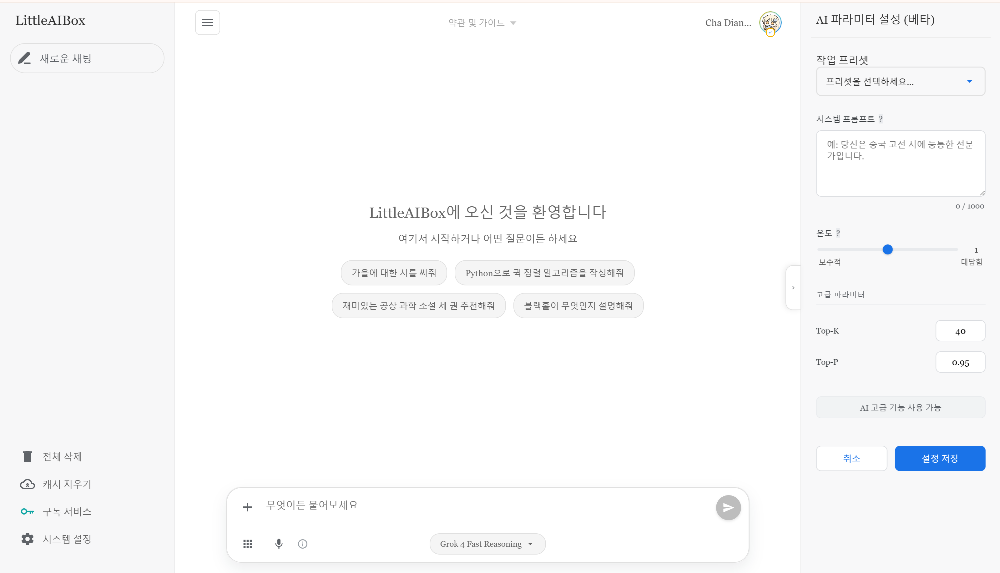
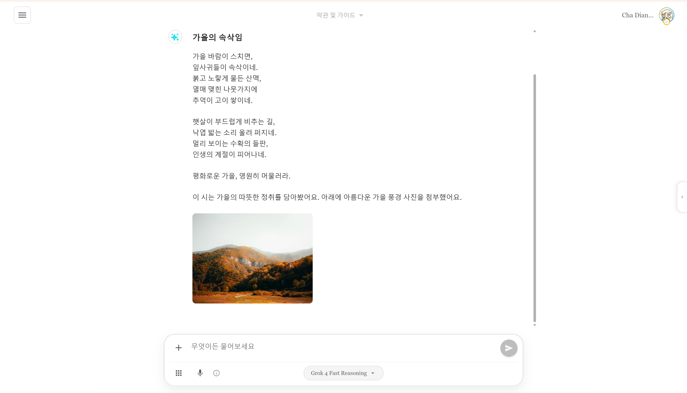
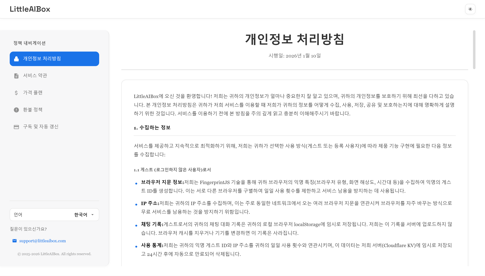

<div align="center">


# LittleAIBox

**현대적인 크로스 플랫폼 AI 대화 어시스턴트**

[](https://opensource.org/licenses/MIT)
[](https://github.com/diandiancha/LittleAIBox)
[](https://github.com/diandiancha/LittleAIBox)
[](https://www.producthunt.com/products/littleaibox)

[中文](README.zh-CN.md) | [English](../README.md) | [日本語](README.ja.md) | [한국어](README.ko.md) | [Español](README.es.md) | [Français](README.fr.md)

이 프로젝트는 지능형 AI 경험을 제공하기 위해 **Google Gemini API**를 사용하여 대화 기능을 구축합니다.

</div>

> **공개 범위와 갱신:** 이 문서는 전체 프로젝트의 기능과 설계를 설명합니다. 공개 저장소는 선택한 프런트엔드 스냅샷이며 백엔드, 결제, 상용 권한 규칙과 인증 정보를 포함하지 않습니다. 3.1.0은 차트·수식, 문서 파서 Worker와 키보드 처리를 갱신합니다. 로컬 분석과 모델로의 전송은 별도 작업입니다. 최신 실행 조건과 구조는 [English README](../README.md)를 참고하세요.

---

> 🎓 이 프로젝트는 교육 및 연구 목적으로 개발되었습니다。

> 💼 상업적 배포 및 프리미엄 서비스는 보안과 지속가능성을 보장하기 위해 작성자가 별도로 운영합니다。

---

## 🎯 이 프로젝트는 누구에게 적합한가요?

LittleAIBox는 다음 사용자에게 완벽합니다:

- **제한된 지역 사용자**: Gemini와의 연결을 쉽게 만드는 내장 서비스 릴레이 솔루션
- **학생 및 연구자**: 브라우저를 떠나지 않고 논문, 프레젠테이션, 문서 분석
- **개발자**: 파일 컨텍스트, 코드 설명, 기술 지원을 통한 코딩 도움
- **콘텐츠 크리에이터**: AI 지원으로 Markdown 콘텐츠 생성 및 편집
- **프라이버시 중심 사용자**: 모든 처리가 로컬에서 수행되며 데이터를 완전히 제어

---

### 🚀 라이브 데모

<div align="center">

**지금 사용해보세요:**  

[](https://littleaibox.com)

</div>

### 💡 왜 LittleAIBox를 선택해야 할까요?

**이 프로젝트의 차별점:**

| 기능 | LittleAIBox | 다른 제품 |
|------|-------------|-----------|
| 파일 처리 | 📄 PPTX, DOCX, PDF, XLSX 지원 | 제한적 또는 서버 측만 |
| 프라이버시 | 🔒 클라이언트 측 처리, 업로드 불필요 | 종종 파일 업로드 필요 |
| 오프라인 지원 | 📱 전체 PWA, 오프라인 작동 | 제한된 오프라인 기능 |
| 크로스 플랫폼 | 🌐 Web + PWA + Android 네이티브 | 일반적으로 Web 또는 모바일만 |
| 프레임워크 | ⚡ Vanilla JS, 제로 비대화 | 종종 React/Vue 종속성 |
| 지역 액세스 | 🌍 내장 서비스 릴레이 솔루션 | 지역적으로 제한될 수 있음 |
| **고가용성** | 🛡️ **엔터프라이즈급 API 풀**，헬스 체크 및 자동 장애 조치 | ❌ 단일 API 종속, 장애에 취약 |
| 오픈 소스 | ✅ 100% 프론트엔드 오픈 소스 | 다양 |
| 비용 | 💰 자체 API 키 사용 | 종종 구독 기반 |

**LittleAIBox를 선택하는 이유**: 최대 프라이버시, 오프라인 우선 설계, 제로 프레임워크 종속성, AI 대화에 대한 완전한 제어.

### 🌟 공식 설명

> **프라이빗하고 글로벌한 AI 채팅 및 통합 플랫폼**
>
> LittleAIBox는 전체 스택, 크로스 플랫폼 Gemini AI 채팅 애플리케이션(Vite/Capacitor/Cloudflare 기반)입니다. 백엔드는 지역 제한을 우회하고 안정적인 글로벌 액세스를 보장하는 지능형 API 풀링 및 프록시 기능을 갖추고 있습니다. 주요 기능:
>
> - 클라이언트 측 파싱(PDF/DOCX/PPTX 지원)
> - Mermaid/LaTeX/Vega-Lite 렌더링, 차트 내보내기 지원
> - 실시간 웹 검색 및 Semantic Scholar 연구 모드
> - 대화 타임라인 내비게이션
> - 듀얼 API 키 관리, 지능형 로드 밸런싱
> - 사용자 정의 가능한 AI 매개변수 및 작업 사전 설정
>
> 문서 분석과 표시는 브라우저에서 처리합니다. 메시지 전송이나 클라우드 기능은 선택한 내용을 설정된 서비스와 모델 제공자에게 보낼 수 있습니다. 로컬 분석은 오프라인 추론을 의미하지 않습니다.
>
> *[Product Hunt에서 보기 →](https://www.producthunt.com/products/littleaibox)*

### 📱 애플리케이션 스크린샷

#### 메인 페이지



#### 예시 페이지



#### 개인정보 페이지



---

## ✨ 주요 기능

### 🎯 **스마트 파일 처리**
- **Office문서**: Word (.docx), PDF, Excel (.xlsx, .xls, .csv), **PowerPoint (.pptx)** 파일을 브라우저에서 직접 파싱
- **리치 미디어**: 이미지 및 Markdown 파일 지원
- **일반 텍스트 파일**: 다양한 텍스트 파일 형식 지원
- **파일 뷰어**: 코드 파일 구문 강조, 이미지 미리보기 및 리치 텍스트 렌더링을 갖춘 내장 파일 뷰어
- **업로드 불필요**: 모든 파일 처리가 클라이언트 측에서 실행되어 최대한의 개인정보 보호

### 🔐 **개인정보 보호 우선 설계**
- **등록 불필요**: 계정을 만들지 않고 즉시 사용 시작
- **다양한 로그인 옵션**: 이메일/비밀번호, OAuth (Google, GitHub) 또는 게스트 모드
- **다중 인증 (MFA)**: 선택적 TOTP 인증 앱 지원, 백업 코드 포함
- **듀얼 API 키 관리**: 두 개의 API 키를 구성하고 지능형 혼합 모드(로드 밸런싱) 또는 단일 모드(백업 전환) 지원
- **자체 API 키 구성**: 자체 Gemini API 키를 사용하여 데이터를 완전히 제어
- **유연한 스토리지**: 등록된 사용자의 API 키는 다중 장치 동기화를 위해 영구 저장되며, 게스트 사용자의 키는 로컬에만 저장되고 페이지 새로고침 시 자동으로 지워져 개인정보를 완전히 보호합니다
- **비밀번호 관리**: 이메일 인증을 통한 안전한 비밀번호 재설정
- **사용자 정의 아바타**: 프로필 아바타 업로드 및 관리

### 🌍 **범용 접근성**
- **지역 제한 해결**: 지리적 제한을 우회하는 내장 서비스 릴레이 라우팅
- **오프라인 우선**: 오프라인 기능을 갖춘 완전한 PWA 지원
- **크로스 플랫폼**: Web, PWA, Android 네이티브 앱에서 원활하게 작동

### 💬 **고급 Markdown 렌더링**
- **코드 하이라이트**: 40+ 프로그래밍 언어 지원
- **수학 표현식**: KaTeX를 사용한 아름다운 수식 렌더링
- **다이어그램**: 인터랙티브 Mermaid 다이어그램 지원, PNG/SVG 내보내기 지원
- **데이터 시각화**: Vega-Lite 차트 렌더링, 인터랙티브 차트 및 PNG 내보내기
- **Mindmap 렌더링**: Markmap 기반 마인드맵 렌더링 및 미리보기
- **차트 내보내기**: 생성된 차트(Mermaid 다이어그램 및 Vega-Lite 시각화)를 PNG 또는 SVG 파일로 다운로드 가능
- **GitHub 스타일**: 구문 강조가 포함된 완전한 GFM 지원
- **스트림 속도 조절**: 전체 프로젝트의 기존 페이서를 재사용하여 지원 모델의 텍스트 도착과 큐 적체에 따라 출력 속도를 조절하고, 다른 모델의 폴백 타이핑 경로는 유지
- **리치 콘텐츠 증분 갱신**: 전체 프로젝트의 DOM 갱신 및 수식 상태 헬퍼를 재사용하여 콘텐츠를 추가하고 재사용 가능한 렌더링 노드를 유지하며, 영역 재구성 후 같은 수식의 가로 스크롤을 복원

### 🛠️ **고급 AI 기능**
- **다양한 상호작용 모드**：
  - **검색 모드**: 최신 정보를 얻기 위한 실시간 웹 검색 통합
  - **연구 모드**: Semantic Scholar API 기반 학술 연구 - 관련 학술 논문을 자동으로 검색 및 인용하고, 구조화된 응답(초록/서론/방법/결과/토론/결론)을 제공하며, 본문 인용 [1], [2]... 제공
  - **이미지 생성 모드**: AI 기반 이미지 생성
- **사용자 정의 AI 매개변수**: AI 동작을 세밀하게 조정:
  - 역할 사용자 정의를 위한 시스템 프롬프트
  - 온도 제어(창의성 vs 일관성)
  - 고급 매개변수(topK, topP)
  - 작업 사전 설정(코딩 어시스턴트, 작성 어시스턴트, 번역, 고전 중국어 연구, 여행 가이드, 역할 놀이 창작)

### 🧾 **생산성 내보내기**
- **다중 포맷 내보내기**: DOCX / PDF / PPTX / XLSX 내보내기 지원
- **구조 보존**: 제목, 목록, 코드, 수식, 표, 다이어그램, 이미지 구조를 최대한 유지

### 🔗 **Bridge 세션 협업**
- **부모-자식 컨텍스트 연계**: 원본 대화의 문맥을 이어받아 대화 연속성 유지

### 📲 **네이티브 업데이트 경험**
- **APK 업데이트 감지**: 새 버전 감지 및 다운로드 페이지 폴백 지원

### 📌 **오픈소스 공개 범위**
- **프론트엔드 공개**: 이 저장소는 프론트엔드 구현만 포함하며 구독/결제 백엔드는 제외

### 🌐 **다국어 지원**
- **6개 언어**: 중국어(간체/번체), 영어, 일본어, 한국어, 스페인어, 프랑스어
- **스마트 감지**: 브라우저 설정에 따른 자동 언어 감지
- **최적화된 로딩**: 즉시 언어 전환을 위한 지능형 번역 캐싱

### 🎨 **아름다운 UI/UX**
- **다크/라이트 모드**: 원활한 테마 전환
- **사용자 정의 폰트**: 시스템 기본값, 세리프, 고정폭 또는 우아한 필기체 폰트 선택 가능
- **반응형 디자인**: 데스크톱, 태블릿, 모바일에서 완벽하게 작동
- **네이티브 느낌**: Capacitor 통합으로 네이티브 모바일 경험
- **대화 타임라인**: 어시스턴트 메시지에 빠르게 액세스하기 위한 플로팅 타임라인 내비게이션

### ⚡ **성능 최적화**
- **빠른 로딩**: 코드 분할을 갖춘 Vite 파워 빌드
- **스마트 캐싱**: 지능형 캐시 전략을 가진 Service Worker
- **경량**: 순수 JavaScript(무거운 프레임워크 없음)

### 🛡️ **엔터프라이즈급 백엔드 아키텍처**
- **탄성 API 키 풀**: 프로덕션 급 멀티 키 순환 및 자동 로드 밸런싱
- **헬스 체크 및 서킷 브레이커**: 실시간 모니터링 및 지능형 장애 조치 보호
- **4단계 지능형 성능 저하**: 장애 상황에서도 원활한 서비스 연속성
- **고가용성**: 자동 지역 제한 우회, 서비스 중단 없음

---

## 🏗️ 아키텍처

### 🏗️ 시스템 아키텍처 다이어그램

```mermaid
flowchart TB
    %% The complete project is shown; the public frontend snapshot is partial.
    subgraph FRONTEND["Complete frontend: Web / PWA / Capacitor; public snapshot is partial"]
        direction TB
        subgraph INTERACTION["Interaction and platform adapters"]
            F_ENTRY["Application entry / routing / settings"]
            F_COMPOSER["Composer / attachments / mode selection"]
            F_KEYBOARD["Native and browser keyboard drivers"]
            F_VIEWPORT["Viewport sampling / scroll anchoring"]
            F_I18N["Locales / themes / resource loading"]
            F_NATIVE["Native bridge / files / sharing / updates"]
        end
        subgraph DOCUMENTS["Document and multimodal processing"]
            F_READERS["PDF / Office / text readers"]
            F_WORKERS["PDF / spreadsheet Workers and fallback"]
            F_IMAGES["Image blobs / hashes / CID references"]
            F_DOC_PLAN["Document intent / task routing / chunks"]
            F_DOC_PROCESS["Summary / retrieval / code structure"]
            F_VISION["Relevant image selection / visual review"]
        end
        subgraph ORCHESTRATION["Request and retrieval orchestration"]
            F_HISTORY["Conversation history / context budget"]
            F_RETRIEVAL["Search / research planning and evidence"]
            F_CONTEXT["Document / image / conversation context"]
            F_ASSEMBLER["Messages / model parameters / request IDs"]
            F_TRANSPORT["Request transport / cancellation / errors"]
        end
        subgraph PRESENTATION["Streaming and productivity"]
            F_STREAM["Response stream / pacing / incremental DOM"]
            F_MARKDOWN["Markdown / highlighting / math protection"]
            F_CHARTS["KaTeX / Mermaid / Vega / mind maps"]
            F_IMAGE_VIEW["CID resolution / generated image layout"]
            F_EXPORT["Word / Excel / PPT / PDF export"]
            F_EXTENSIONS["Canvas / entertainment modules: not synced"]
        end
        subgraph CLIENT_STATE["Conversation and local state"]
            F_CHAT["Conversations / turns / message identity"]
            F_SYNC["Save queue / sync state / remote changes"]
            F_CACHE["IndexedDB / cache policy / eviction"]
            F_PWA["Service Worker / PWA cache and updates"]
            F_BRIDGE["Parent-child conversation context bridge"]
        end
    end

    subgraph SHARED["Frontend/backend contracts: shared-runtime"]
        S_MODELS["Model metadata / request and context policy"]
        S_ATTACH["Image protocol / attachment hashes and persistence"]
        S_SYNC["Conversation / turn order and sync state"]
    end

    subgraph SERVICE["Cloudflare Pages Functions: backend source not included"]
        B_GATEWAY["Unified entry / version checks / routing"]
        B_SESSION["Sessions / visitor identity / access control"]
        B_AUTH["Email login / OAuth / MFA / password flows"]
        B_DATA["Conversation / turn / attachment / share APIs"]
        B_MODEL["Model requests / tools / streamed responses"]
        B_SEARCH["Web / image / academic retrieval"]
        B_RESOURCE["Image generation / resource proxying"]
        B_STORAGE["Message commits / titles / attachment lifecycle"]
    end

    subgraph MODEL_RELIABILITY["Model integration and reliability responsibilities"]
        M_ADAPTER["Model catalog / parameters / provider adapters"]
        M_KEYS["User keys / server pools / health statistics"]
        M_RETRY["Retry / circuit breaking / controlled fallback"]
        M_LIMITER["Rate limiter Worker / Durable Object"]
    end

    subgraph INFRASTRUCTURE["Storage and background maintenance"]
        D_DATABASE["D1: users / sessions / messages / settings"]
        D_OBJECTS["R2: document sources / images / avatars"]
        D_KV["KV: session state / cache / temporary state"]
        D_QUEUE["Cleanup queue / delayed retries"]
        D_CLEANUP["Cleanup consumer / referenced-resource checks"]
        D_CRON["Scheduled maintenance / retry scheduling"]
        D_DLQ["Dead-letter queue / manual investigation"]
    end

    subgraph EXTERNAL["External identity, data and model providers"]
        X_MODELS["Gemini / OpenAI-compatible / Claude services"]
        X_WEB["Brave web and image search"]
        X_ACADEMIC["Semantic Scholar / OpenAlex"]
        X_IMAGE["Image generation providers"]
        X_IDENTITY["Google / GitHub OAuth"]
        X_EMAIL["Email delivery service"]
    end

    S_MODELS -.-> F_HISTORY
    S_MODELS -.-> M_ADAPTER
    S_ATTACH -.-> F_IMAGES
    S_ATTACH -.-> B_STORAGE
    S_SYNC -.-> F_SYNC
    S_SYNC -.-> B_STORAGE

    %% Solid links: main data/request paths; dotted links: coordination or lifecycle work.
    F_ENTRY --> F_COMPOSER
    F_I18N -.-> F_ENTRY
    F_ENTRY -.-> F_EXTENSIONS
    F_NATIVE -.-> F_COMPOSER
    F_KEYBOARD --> F_VIEWPORT
    F_VIEWPORT -.-> F_ENTRY
    F_COMPOSER --> F_READERS
    F_READERS --> F_WORKERS
    F_READERS --> F_IMAGES
    F_READERS --> F_DOC_PLAN
    F_DOC_PLAN --> F_DOC_PROCESS
    F_IMAGES --> F_VISION
    F_DOC_PROCESS --> F_CONTEXT
    F_DOC_PROCESS -.-> F_TRANSPORT
    F_VISION -.-> F_TRANSPORT
    F_VISION --> F_CONTEXT
    F_COMPOSER --> F_CONTEXT
    F_HISTORY --> F_CONTEXT
    F_RETRIEVAL --> F_CONTEXT
    F_BRIDGE --> F_HISTORY
    F_CONTEXT --> F_ASSEMBLER --> F_TRANSPORT
    F_TRANSPORT --> B_GATEWAY
    F_RETRIEVAL --> B_GATEWAY
    B_MODEL --> F_STREAM
    F_STREAM --> F_MARKDOWN
    F_MARKDOWN --> F_CHARTS
    F_STREAM --> F_IMAGE_VIEW
    F_CHARTS --> F_ENTRY
    F_IMAGE_VIEW --> F_ENTRY
    F_MARKDOWN --> F_EXPORT
    F_MARKDOWN -.-> F_EXTENSIONS
    F_STREAM --> F_CHAT
    F_CHAT --> F_HISTORY
    F_CHAT --> F_SYNC
    F_SYNC <--> F_CACHE
    F_IMAGES --> F_CACHE
    F_PWA -.-> F_ENTRY
    F_SYNC <--> B_GATEWAY
    B_GATEWAY --> B_SESSION
    B_GATEWAY --> B_AUTH
    B_SESSION --> B_DATA
    B_SESSION --> B_MODEL
    B_SESSION --> B_SEARCH
    B_SESSION --> B_RESOURCE
    B_AUTH --> X_IDENTITY
    B_AUTH --> X_EMAIL
    B_AUTH --> D_DATABASE
    B_SESSION --> D_KV
    B_DATA --> B_STORAGE
    B_STORAGE --> D_DATABASE
    B_STORAGE --> D_OBJECTS
    B_MODEL --> M_ADAPTER
    M_ADAPTER --> M_RETRY
    M_KEYS -.-> M_RETRY
    M_LIMITER -.-> B_MODEL
    M_RETRY --> X_MODELS
    B_SEARCH --> X_WEB
    B_SEARCH --> X_ACADEMIC
    B_RESOURCE --> X_IMAGE
    B_RESOURCE --> D_OBJECTS
    B_SEARCH -.-> D_KV
    B_STORAGE -.-> D_QUEUE
    D_CRON --> D_QUEUE
    D_QUEUE --> D_CLEANUP
    D_CLEANUP --> D_DATABASE
    D_CLEANUP --> D_OBJECTS
    D_CLEANUP -.-> D_DLQ

    classDef frontend fill:#e8f1ff,stroke:#5276a7,color:#172b4d
    classDef backend fill:#fff3dc,stroke:#ab7d32,color:#49330d
    classDef storage fill:#edf3ef,stroke:#63836c,color:#203e2b
    classDef external fill:#f0eafa,stroke:#8466a6,color:#39244f
    classDef shared fill:#eff3f7,stroke:#748598,color:#25384b
    classDef extension fill:#f7edf3,stroke:#ad6d91,color:#54243f
    class F_ENTRY,F_COMPOSER,F_KEYBOARD,F_VIEWPORT,F_I18N,F_NATIVE frontend
    class F_READERS,F_WORKERS,F_IMAGES,F_DOC_PLAN,F_DOC_PROCESS,F_VISION frontend
    class F_HISTORY,F_RETRIEVAL,F_CONTEXT,F_ASSEMBLER,F_TRANSPORT frontend
    class F_STREAM,F_MARKDOWN,F_CHARTS,F_IMAGE_VIEW,F_EXPORT frontend
    class F_CHAT,F_SYNC,F_CACHE,F_PWA,F_BRIDGE frontend
    class B_GATEWAY,B_SESSION,B_AUTH,B_DATA,B_MODEL,B_SEARCH,B_RESOURCE,B_STORAGE,M_ADAPTER,M_KEYS,M_RETRY,M_LIMITER backend
    class D_DATABASE,D_OBJECTS,D_KV,D_QUEUE,D_CLEANUP,D_CRON,D_DLQ storage
    class X_MODELS,X_WEB,X_ACADEMIC,X_IMAGE,X_IDENTITY,X_EMAIL external
    class F_EXTENSIONS extension
    class S_MODELS,S_ATTACH,S_SYNC shared
```



### 🧩 프론트엔드 스택

**핵심 기술**
- **빌드 도구**: Vite 7.x
- **프레임워크**: 바닐라 JavaScript (ES6+ Modules) - 프레임워크 오버헤드 제로
- **스타일링**: Tailwind CSS 4.x
- **모바일**: Capacitor 7.x (Android 지원)

**주요 라이브러리**
- **Markdown**: marked.js + DOMPurify
- **코드 하이라이트**: highlight.js (40+ 언어)
- **수식 렌더링**: KaTeX
- **차트**: Mermaid, Vega-Lite
- **파일 파싱**: mammoth (Word), PDF.js, xlsx, pptx2html
- **스토리지**: IndexedDB + localStorage
- **인증**: 서버 세션과 OAuth 2.0 통합 (Google, GitHub)
- **보안**: MFA/TOTP 지원, 백업 코드 포함

### 💾 클라이언트 측 처리

모든 파일 파싱 및 처리는 완전히 브라우저 내에서 실행됩니다:
- **PPTX 파싱**: PowerPoint 콘텐츠의 완전한 추출
- **PDF 읽기**: 텍스트 및 메타데이터 추출
- **Excel 처리**: 스프레드시트 데이터 파싱 (.xlsx, .xls, .csv)
- **Word 문서**: 형식 보존 DOCX 파일 파싱
- **이미지 처리**: 클라이언트 측 이미지 처리 및 base64 인코딩

### 오프라인 지원

- **Service Worker**: 사용자 정의 캐시 전략
- **IndexedDB**: 로컬 채팅 기록 및 설정 스토리지
- **프로그레시브 웹 앱**: 설치 가능하고 오프라인에서 작동

### 🛡️ 백엔드 아키텍처

본 프로젝트의 백엔드는 **Cloudflare Pages** 위에 구축되었으며, 현대적인 서버리스 아키텍처를 채택하고 있습니다.

**왜 백엔드가 클로즈드 소스인가요?**

투명성에 헌신하고 있지만, 백엔드는 다음과 같은 중요한 이유로 클로즈드 소스로 유지됩니다:

1. **보안**: 사용자 데이터, API 키 및 인증 메커니즘 보호
2. **비용 관리**: API 키 남용 방지 및 지속 가능한 서비스 비용 보장
3. **인프라**: 독점적 최적화 전략 및 장애 조치 시스템 보호
4. **규정 준수**: 지역 요구사항을 충족하면서 서비스 품질 유지

**무엇이 투명한가요?**

- ✅ 모든 프론트엔드 코드는 오픈 소스이며 MIT 라이선스
- ✅ 모든 API 엔드포인트는 공개되어 있으며 잘 문서화됨
- ✅ 모든 네트워크 요청을 검사할 수 있음
- ✅ 클라이언트 측 처리는 완전히 감사 가능
- ✅ 숨겨진 추적 또는 데이터 수집 없음

**개발자를 위해**: 프론트엔드 코드는 모든 백엔드 상호 작용을 보여주며, 자체 백엔드를 구축하거나 동일한 API를 사용하여 전체 스택을 자체 호스팅할 수 있습니다. 모든 API는 공개되어 있으며 안정적입니다.

#### 핵심 데이터베이스 계층

**Cloudflare D1 (SQLite)**
- 완전한 사용자 인증 시스템, 여러 로그인 방법 지원:
  - 안전한 PBKDF2 해시를 사용한 이메일/비밀번호
  - OAuth 2.0 통합 (Google, GitHub)
  - 익명 사용을 위한 게스트 모드
- 다중 인증 (MFA) 지원:
  - TOTP 인증 앱 통합
  - 백업 코드 생성 및 관리
- 서버 세션 기록으로 만료, 무효화 및 다중 기기 로그인을 관리
- 이메일 인증을 통한 비밀번호 재설정 흐름
- 쿼리 및 복구 지원이 있는 채팅 기록 영구 저장
- 사용자 구성 및 기본 설정 관리

#### 핵심: 탄력적 API 키 풀 (APIKeyPool)

이 시스템은 프로덕션 등급의 고가용 API 키 관리 시스템을 제공합니다:

- **다중 키 로테이션**: 여러 Gemini 및 Brave Search API 키를 지능적으로 관리하며 자동 로드 밸런싱 제공
- **헬스 체크 메커니즘**: 각 키의 가용성 및 응답 품질을 실시간으로 모니터링
- **자동 장애 조치**: 키가 실패하거나 속도 제한에 도달하면 백업 키로 원활하게 전환
- **서킷 브레이커 보호**: 짧은 시간 내 실패한 키에 대한 반복 요청을 방지하여 시스템 리소스 보호
- **지능형 재시도 전략**: 지수 백오프 알고리즘으로 요청 성공률 최대화

#### 핵심: 지능형 저하 및 폴백 시스템 (Smart Failover)

신중하게 설계된 4계층 지능형 저하 아키텍처를 구현하여 높은 가용성 및 서비스 연속성 보장:

1. **사용자 키 우선순위**: 사용자가 구성한 API 키를 우선적으로 사용
2. **하이브리드 모드**: 사용자 키를 기반으로 서버 키를 지능적으로 보완
3. **단일 키 모드**: 단일 서버 키를 백업 솔루션으로 사용
4. **서버 폴백**: 최종 보장 메커니즘으로 서비스가 영구적으로 중단되지 않도록 보장

이 시스템은 지역 제한, 무효한 키, 네트워크 장애 등의 문제를 자동으로 감지하고 우회하여 사용자에게 지속적이고 안정적인 서비스 경험을 제공합니다.

#### 통합 서비스 생태계

**이메일 서비스**
- **Resend**: 안전한 이메일 인증 및 비밀번호 재설정 흐름에 사용
- HTML 템플릿 및 국제화 이메일 콘텐츠 지원
- 이메일 기반 계정 복구 및 인증

**검색 및 콘텐츠**
- **Brave Search API**: 고품질 웹 검색 결과를 제공하여 AI 컨텍스트 이해 향상
- **학술 정보원**: 현재 전체 서비스는 Semantic Scholar와 OpenAlex를 통합

**이미지 생성**
- **pollinations.ai**: 여러 예술적 스타일을 지원하는 고성능 이미지 생성 서비스
- 사용자 개인정보 보호를 위한 클라이언트 측 프록시 서비스

**클라우드 스토리지**
- **Cloudflare R2**: 사용자 아바타 및 첨부 파일 저장을 위한 S3 호환 객체 스토리지
- 글로벌 CDN 가속, 낮은 지연 시간 액세스
- **Cloudflare KV**: 캐싱, 세션 관리 및 사용량 제한 추적을 위한 고성능 키-값 스토리지

---

## 📚 문서 탐색

<div align="center">

**프로젝트 리소스 빠른 접근**

[](LEARN.ko.md) 
[](CONTRIBUTING.ko.md) 
[](../.github/CODE_OF_CONDUCT.md) 
[](../.github/SECURITY.md)

**📖 [전체 문서 인덱스](../docs/)**

</div>

---

## 📁 프로젝트 구조

```
LittleAIBox/
├── src/                    # 소스 코드
│   ├── main.js            # 메인 애플리케이션 로직
│   ├── stream-pacer.js    # 전체 프로젝트에서 가져온 적응형 출력 페이서
│   ├── stream-text-update.js # 증분 DOM 갱신 계획 및 반영
│   ├── api-config.js      # API 설정
│   ├── auth-oauth.js     # OAuth 인증 (Google, GitHub)
│   ├── auth-template.js  # 인증 UI 템플릿
│   ├── auth.css          # 인증 스타일
│   ├── db.js              # IndexedDB 래퍼
│   ├── i18n.js            # 국제화
│   ├── mermaid-renderer.js # 다이어그램 렌더링
│   ├── vega-renderer.js    # Vega-Lite 차트 렌더링
│   ├── floating-timeline.js # 대화 타임라인 내비게이션
│   ├── floating-timeline.css # 타임라인 스타일
│   ├── mfa-login.js      # 다중 인증
│   ├── oauth-flow.js     # OAuth 플로우 처리
│   ├── router.js         # 클라이언트 측 라우팅
│   ├── style.css          # 전역 스타일
│   └── sw-custom.js       # Service Worker
├── public/                 # 정적 자산
│   ├── locales/           # 번역 파일 (6개 언어)
│   ├── libs/              # 서드파티 라이브러리
│   ├── images/            # 이미지 및 아이콘
│   └── manifest.webmanifest # PWA 매니페스트
├── appshow/                # 언어별 스크린샷
├── docs/                   # 문서 (다국어)
├── capacitor.config.json   # 모바일 앱 설정
├── vite.config.js          # 빌드 설정
├── tailwind.config.js      # Tailwind CSS 설정
└── package.json            # 종속성
```

---

## 🚀 시작하기

### 📝 사용 안내

**사용 안내**: 더 나은 경험을 위해 Gemini API 키를 설정하는 것을 권장합니다. 등록이 필요 없으며 설정 페이지에서 API 키를 입력하기만 하면 사용을 시작할 수 있습니다.

API 키 얻기: [Google AI Studio](https://aistudio.google.com/api-keys)

### 사전 요구사항

- Node.js **^20.19.0 || >=22.12.0**
- npm 또는 yarn
- Gemini API 키 (선택사항, 최상의 경험을 위해 권장)

> **참고**: 서비스는 공유 API 키로 작동하지만, 더 나은 성능과 개인정보 보호를 위해 자체 API 키를 사용하는 것을 강력히 권장합니다.

### 설치

```bash
# 저장소 클론
git clone https://github.com/diandiancha/LittleAIBox.git
cd LittleAIBox

# 종속성 설치
npm install

# 개발 서버 시작
npm run dev

# 프로덕션 빌드
npm run build
```

### 구성

1. **API 키 얻기** (아직 없는 경우):
   - [Google AI Studio](https://aistudio.google.com/api-keys) 방문
   - 새 API 키 만들기
   - 앱에서 사용할 키 복사

2. **앱에서 구성**:
   - 앱 열기: [LittleAIBox](https://littleaibox.com)
   - 설정 페이지로 이동
   - Gemini API 키 입력
   - 저장하고 채팅 시작!

3. **계정 옵션** (선택사항):
   - **계정 만들기**: 이메일/비밀번호로 등록하거나 OAuth (Google/GitHub) 사용
   - **MFA 활성화**: 설정 → 보안으로 이동하여 TOTP 인증 앱 설정
   - **게스트 모드**: 등록 없이 사용 (API 키는 로컬에만 저장)

### 문제 해결

**일반적인 문제:**

| 문제 | 해결책 |
|------|--------|
| API 키가 작동하지 않음 | Google AI Studio의 키이고 남은 할당량이 있는지 확인 |
| 파일이 파싱되지 않음 | 브라우저 콘솔 오류 확인; 지원되는 파일 형식인지 확인 |
| 응답이 느림 | 네트워크 연결 확인; 자체 API 키 사용 고려 |
| 모바일 빌드 실패 | Android Studio가 설치되고 환경이 올바르게 설정되었는지 확인 |

**도움이 필요하신가요?**
- [Issues](https://github.com/diandiancha/LittleAIBox/issues)에서 알려진 문제 확인
- 문제 세부정보와 함께 새 issue 열기

### 모바일 빌드

```bash
# Android 플랫폼 추가
npx cap add android

# 파일 동기화
npx cap sync

# Android Studio에서 열기
npx cap open android
```

---

## 🎯 사용 사례

- **학술 연구**: 연구 논문, 프레젠테이션 파싱 및 분석
- **콘텐츠 생성**: AI를 사용한 Markdown 콘텐츠 생성 및 편집
- **코드 지원**: 프로그래밍 작업 및 코드 설명 도움
- **문서 분석**: Office 문서에서 인사이트 추출
- **학습 도구**: 파일 첨부를 지원하는 인터랙티브 AI 튜토링

---

## 🤝 기여

기여를 환영합니다! 버그 수정, 기능 추가 또는 문서 개선 등 모든 기여가 LittleAIBox를 더 나은 것으로 만듭니다.

### 기여 방법

1. **저장소 포크** 및 로컬로 복제
2. **브랜치 생성**: `git checkout -b feature/your-feature-name`
3. **변경 사항 만들기** 및 철저히 테스트
4. **변경 사항 커밋**: `git commit -m "Add: 변경 사항 설명"`
5. **포크에 푸시**: `git push origin feature/your-feature-name`
6. **Pull Request 열기** 및 명확한 변경 사항 설명 제공

### 가이드라인

- 기존 코드 스타일 및 규칙 준수
- 복잡한 논리에 대한 주석 추가
- 새 기능에 대한 문서 업데이트
- 명확한 커밋 메시지 작성
- 제출 전 변경 사항 테스트

### 로드맵

다음 기능을 적극적으로 개발 중:

- 🌐 iOS 지원 (Capacitor)
- 📊 더 많은 파일 형식 지원
- 🎨 사용자 정의 테마
- 🔌 플러그인 시스템
- 🌍 더 많은 언어
- 📱 향상된 모바일 기능

아이디어가 있으신가요? [Issue 열기](https://github.com/diandiancha/LittleAIBox/issues) 또는 토론 시작!

---

## 🔒 개인정보 보호 및 보안

- **클라이언트 측 처리**: 파일 파싱은 브라우저 내에서 실행됩니다
- **로컬 스토리지**: 채팅 기록이 로컬에 저장(선택적 클라우드 동기화)
- **안전한 인증**：
  - 다양한 로그인 옵션 (이메일/비밀번호, OAuth)
  - 향상된 보안을 위한 선택적 MFA/TOTP
  - 이메일 인증을 통한 안전한 비밀번호 재설정
- **추적 없음**: 개인정보 보호 우선 설계
- **오픈 소스**: 투명하고 감사 가능한 코드
- **API 키 처리**: 키는 민감한 설정입니다. 공개 빌드 변수나 커밋에 포함하지 마세요

🧠 **로컬 분석, 모델 요청과 클라우드 동기화는 별도 작업입니다. 네트워크 기능에서는 내용이 기기 밖으로 전송됩니다.**

---

## 📄 라이선스

이 프로젝트는 [MIT License](../LICENSE) 하에 라이선스되어 있습니다.

Copyright (c) 2025 diandiancha

---

<div align="center">

Made with ❤️ by diandiancha

**도움이 되었다면 ⭐ 스타를 주세요!**

💬 **질문이나 피드백이 있으신가요? [Issue 열기](https://github.com/diandiancha/LittleAIBox/issues) — 모든 것을 읽고 있습니다!**

</div>
