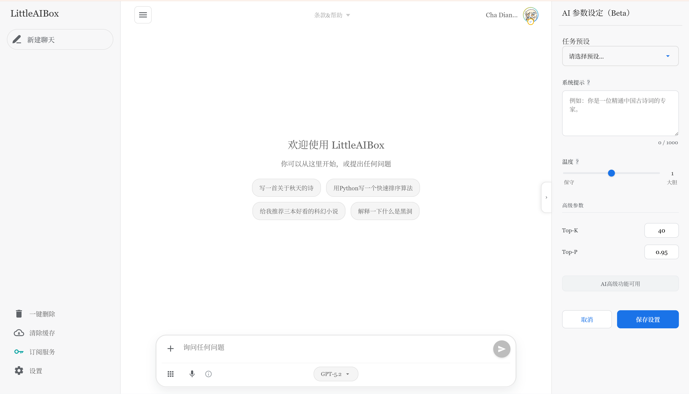
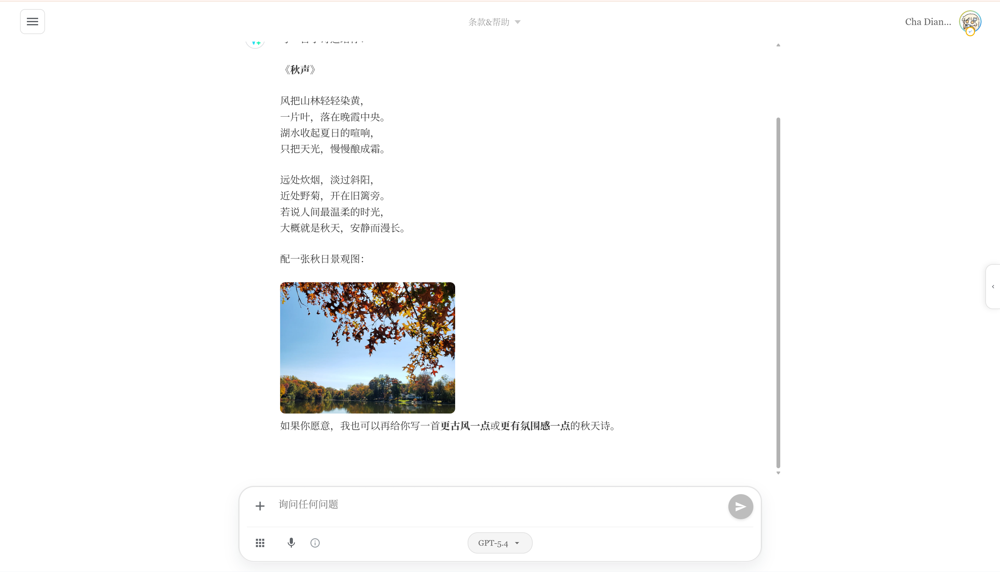
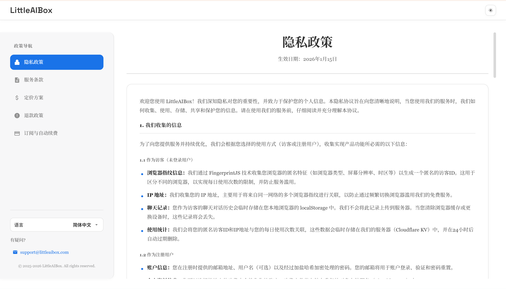

<div align="center">


# LittleAIBox

**现代化跨平台 AI 对话助手**

[](https://opensource.org/licenses/MIT)
[](https://github.com/diandiancha/LittleAIBox)
[](https://github.com/diandiancha/LittleAIBox)
[](https://www.producthunt.com/products/littleaibox)

[中文](README.zh-CN.md) | [English](../README.md) | [日本語](README.ja.md) | [한국어](README.ko.md) | [Español](README.es.md) | [Français](README.fr.md)

LittleAIBox 将浏览器端文档处理、AI 请求编排和流式富文本渲染组合为跨平台应用。Gemini 是最初的模型集成，独立维护的服务端还支持其他模型供应商。

</div>

---

> 🎓 本项目为教育和研究目的而开发。

> 💼 商业部署和高级服务由作者独立运营，以确保安全性和可持续性。

> **阅读说明：** 下文保留完整项目的功能、后端架构与工程机制介绍，便于理解系统如何运行。本仓库公开前端快照及选定核心机制，不包含后端源码、支付处理、生产凭据和商业权益规则；架构中出现某个服务，不代表该服务的实现已随仓库提供。

---

## 🎯 适用人群

LittleAIBox 非常适合：

- **受限地区用户**：内置服务中转方案，轻松连接您与 Gemini
- **学生和研究人员**：在浏览器中分析论文、演示文稿和文档
- **开发人员**：获取编程帮助、文件上下文、代码解释和技术支持
- **内容创作者**：使用 AI 支持生成和编辑 markdown 内容
- **注重隐私的用户**：在本地解析文档，并明确哪些内容会发送给后端及模型供应商

---

### 🚀 在线体验

<div align="center">

**立即访问:**  

[](https://littleaibox.com)

</div>

### 💡 为什么选择 LittleAIBox？

**这个项目的与众不同之处：**

| 能力 | 实现机制 | 运行边界 |
|------|-------------|----------|
| 文件处理 | 📄 PDF/Office 读取、Worker 与 DOM 解析路径 | 浏览器执行，选中内容可进入模型请求 |
| 富文本渲染 | 📐 Markdown、KaTeX、Mermaid 与 Vega | 浏览器执行，异步渲染与聊天滚动协调 |
| 离线状态 | 📱 Service Worker 与 IndexedDB | 缓存页面外壳和本地数据，在线推理仍需服务 |
| 跨平台 | 🌐 Web、PWA 与 Capacitor 适配 | 原生行为需要生成平台工程并验证设备 |
| 应用界面 | ⚡ 原生 JavaScript 与 Vite 模块 | 解析和渲染使用相应第三方库 |
| 模型接入 | 🔌 上下文组装与供应商协议适配 | 前端请求及兼容后端共同完成 |
| 故障恢复 | 🛡️ 密钥统计、重试与熔断 | 独立维护的服务端实现 |
| 开源 | ✅ 选定前端快照采用 MIT 许可证 | 介绍完整架构，不包含后端实现 |
| 自备密钥 | 🔑 BYOK 配置 | 仍受供应商与兼容后端接入要求约束 |

**工程重点**：可审阅的浏览器处理、明确的服务边界、流式富文本渲染和跨平台交互。

### 🌟 官方描述

> **私密、全球化的 AI 聊天与集成平台**
>
> LittleAIBox 是基于 Vite、Capacitor 和 Cloudflare 的全栈跨平台 AI 聊天应用。前端负责本地文档处理与富文本交互，服务层负责模型接入、检索、会话和故障恢复。主要功能包括：
>
> - 客户端解析（支持 PDF/DOCX/PPTX）
> - Mermaid/LaTeX/Vega-Lite 渲染，支持图表导出
> - 实时网页搜索与 Semantic Scholar 研究模式
> - 对话时间线导航
> - 双 API 密钥管理，智能负载均衡
> - 可自定义的 AI 参数和任务预设
>
> 浏览器负责文档解析、本地状态和流式结果渲染；发起模型请求时，选中的消息与附件内容会发送给配置的服务端及模型供应商，账户和云同步也需要相应服务。这种分工使文档预处理和显示逻辑可以在前端审阅，同时由服务层管理模型访问、失败重试和远程同步。
>
> *[在 Product Hunt 上查看 →](https://www.producthunt.com/products/littleaibox)*

### 📱 应用截图

以下截图展示较早版本的界面，个别控件可能与当前公开快照不同。

#### 主页面



#### 示例页面



#### 隐私页面



---

## ✨ 核心亮点

### 🎯 **强大的文件处理能力**
- **Office 文档解析**: 直接在浏览器中解析 Word (.docx)、PDF、Excel (.xlsx, .xls, .csv) 和 **PowerPoint (.pptx)** 文件
- **富媒体支持**: 支持图片和 Markdown 文件
- **纯文本文件**: 支持各种文本文件格式
- **文件查看器**: 内置文件查看器，支持代码文件语法高亮、图片预览和富文本渲染
- **本地解析**: 在浏览器提取文件内容；把内容发送给模型或保存到云端属于独立的网络操作
- **解析生命周期**: 支持解析 Worker、主线程回退、进度报告及按进度续期的空闲超时控制

### 🔐 **隐私优先设计**
- **无需注册**: 直接使用，无需创建账户即可开始体验
- **多种登录方式**: 邮箱/密码、OAuth（Google、GitHub）或访客模式
- **多因素认证 (MFA)**: 可选的 TOTP 验证器应用支持，带备用验证码
- **双 API 密钥管理**: 配置两个 API 密钥，支持智能混合模式（负载均衡）或单模式（备用切换）
- **自行配置 API Key**: 通过兼容服务的设置接口配置自己的供应商密钥
- **灵活存储**: 注册用户的 API 密钥会持久化保存，方便多设备同步；访客用户的密钥仅存储在本地，刷新页面后自动清除，充分保障隐私
- **密码管理**: 通过邮箱验证安全重置密码
- **自定义头像**: 上传和管理您的个人资料头像

### 🌍 **无障碍访问**
- **服务路由**: 支持中转接入，可用性仍取决于后端、供应商和网络条件
- **离线状态**: 缓存 PWA 页面外壳和本地数据；模型推理与搜索仍需联网服务
- **跨平台适配**: Web/PWA 界面及 Capacitor 适配，原生行为需要设备验证

### 💬 **专业级 Markdown 渲染**
- **代码高亮**: 通过仓库自带 highlight.js 支持常见编程语言
- **数学公式**: 使用 KaTeX 渲染精美数学表达式
- **流程图**: 支持交互式 Mermaid 图表，支持 PNG/SVG 导出
- **数据可视化**: Vega-Lite 图表渲染，支持交互式图表和 PNG 导出
- **脑图渲染**: 支持基于 Markmap 的脑图渲染与预览
- **图表导出**: 可下载生成的图表（Mermaid 图表和 Vega-Lite 可视化）为 PNG 或 SVG 文件
- **GitHub 风格**: 完整的 GFM 语法支持
- **流式配速**: 复用完整项目已有配速器，按文本到达情况和队列积压调整适配模型的输出节奏，其他模型保留回退打字路径
- **富文本增量更新**: 复用完整项目已有 DOM 提交和公式状态机制，优先追加内容、保留可复用的已渲染节点，并在区域重建后恢复相同公式的横向滚动位置

### 🛠️ **高级 AI 功能**
- **多种交互模式**：
  - **搜索模式**: 实时网络搜索集成，获取最新信息
  - **研究模式**: 通过兼容服务检索学术来源并生成引用；完整项目当前集成 Semantic Scholar 和 OpenAlex，公开快照保留原有研究接口
  - **生图模式**: AI 驱动的图像生成
- **自定义 AI 参数**: 精细调整 AI 行为：
  - 系统提示，用于角色定制
  - 温度控制（创造性 vs 一致性）
  - 高级参数（topK、topP）
  - 任务预设（编程助手、写作助手、翻译、古文研究、旅行向导、角色扮演创作）

### 🧾 **生产力导出**
- **多格式导出**: 支持将对话/内容导出为 DOCX、PDF、PPTX、XLSX
- **内容保真**: 保留标题、列表、代码块、公式、表格、图表、图片等结构

### 🔗 **Bridge 会话协作**
- **父子上下文衔接**: 支持从源会话继承上下文，继续对话

### 📲 **原生更新体验**
- **APK 更新检测**: 支持新版本检测，并在需要时回退到下载页

### 📌 **开源范围说明**
- **前端开源包**: 本仓库仅包含开源前端实现，订阅/支付后端已省略
- **服务依赖功能**: 登录、云同步、搜索和模型回复需要兼容服务，前端存在入口不代表仓库自带对应后端
- **快照范围**: 独立维护应用中的 Canvas 与娱乐模块不在本轮核心同步范围内

### 🌐 **多语言支持**
- **7 份语言目录**: 简体中文、繁体中文、英语、日语、韩语、西班牙语、法语
- **智能检测**: 根据浏览器设置自动检测语言
- **翻译缓存**: 缓存语言资源，减少重复加载

### 🎨 **精美界面设计**
- **深色/浅色模式**: 无缝主题切换
- **自定义字体**: 可选择系统默认、衬线字体、等宽字体或典雅楷体
- **响应式布局**: 桌面、平板、手机完美适配
- **原生体验**: Capacitor 集成，移动端原生般流畅
- **对话时间线**: 浮动时间线导航，快速访问助手消息

### ⚡ **极致性能优化**
- **快速加载**: Vite 构建，代码分割优化
- **智能缓存**: Service Worker 智能缓存策略
- **原生 JS 主界面**: 使用 JavaScript 模块组织应用，解析和渲染复用第三方库

### 🛡️ **企业级后端架构**
- **弹性 API 密钥池**: 生产级多密钥轮换与自动负载均衡
- **密钥健康与熔断**: 根据请求成功/失败统计维护状态并隔离失败密钥，不等同于持续探测上游或评估回答质量
- **受控回退**: 区分密钥选择、运行模式和失败恢复，不把它们描述为所有请求必经的四层流水线
- **故障恢复**: 重试、熔断及受控回退降低临时故障影响，但不承诺服务永不中断

---

## 🏗️ 技术架构

下图描述完整应用的前端、服务层和基础设施。后端节点用于解释系统设计，其实现及生产部署配置不在本公开仓库中。

展开图按完整项目的职责组织：交互与平台适配、文档处理、请求编排、流式显示、状态同步、前后端共享约定、后端接口、模型可靠性及后台维护。实线表示主要请求/数据路径，虚线表示协调、中间处理或生命周期操作；这些方块不代表独立部署，也不是所有请求必经的固定步骤。

颜色区分前端、后端、共享约定、存储维护和外部供应商，粉色标出本轮未同步的扩展。公开快照只同步选定核心机制，并未包含所有新版前端模块及最新会话/上下文实现；后端实现和生产配置仍独立维护。

### 🏗️ 系统架构图

```mermaid
flowchart TB
    %% The complete project is shown; the public frontend snapshot is partial.
    subgraph FRONTEND["完整项目前端：Web / PWA / Capacitor（公开快照仅同步部分）"]
        direction TB
        subgraph INTERACTION["交互与平台适配"]
            F_ENTRY["应用入口 / 路由 / 设置"]
            F_COMPOSER["输入框 / 附件入口 / 模式选择"]
            F_KEYBOARD["原生与浏览器键盘驱动"]
            F_VIEWPORT["视口测量 / 滚动锚点"]
            F_I18N["多语言 / 主题 / 资源加载"]
            F_NATIVE["原生桥接 / 文件 / 分享 / 更新"]
        end
        subgraph DOCUMENTS["文档与多模态处理"]
            F_READERS["PDF / Office / 文本读取"]
            F_WORKERS["PDF / 表格 Worker 与主线程回退"]
            F_IMAGES["图片 Blob / 哈希 / CID 引用"]
            F_DOC_PLAN["文档意图 / 任务路由 / 分块"]
            F_DOC_PROCESS["摘要 / 文档检索 / 代码结构解析"]
            F_VISION["相关图片筛选 / 视觉复核"]
        end
        subgraph ORCHESTRATION["请求与检索编排"]
            F_HISTORY["会话历史 / 模型上下文预算"]
            F_RETRIEVAL["搜索 / 研究：查询计划与证据"]
            F_CONTEXT["统一文档 / 图片 / 对话上下文"]
            F_ASSEMBLER["消息组装 / 模型参数 / 请求标识"]
            F_TRANSPORT["请求发送 / 取消 / 失败处理"]
        end
        subgraph PRESENTATION["流式显示与生产力"]
            F_STREAM["响应流 / 节奏控制 / 增量更新"]
            F_MARKDOWN["Markdown / 高亮 / 公式保护"]
            F_CHARTS["KaTeX / Mermaid / Vega / 脑图"]
            F_IMAGE_VIEW["CID 还原 / 生成图片布局"]
            F_EXPORT["Word / Excel / PPT / PDF 导出"]
            F_EXTENSIONS["Canvas / 娱乐扩展：本轮未同步"]
        end
        subgraph CLIENT_STATE["会话与本地数据"]
            F_CHAT["对话 / 轮次 / 消息标识"]
            F_SYNC["保存队列 / 同步状态 / 远程变更"]
            F_CACHE["IndexedDB / 缓存策略 / 清理"]
            F_PWA["Service Worker / PWA 缓存与更新"]
            F_BRIDGE["父子会话桥接 / 上下文继承"]
        end
    end

    subgraph SHARED["前后端共享约定：shared-runtime"]
        S_MODELS["模型元数据 / 请求与上下文策略"]
        S_ATTACH["图片协议 / 附件哈希与持久化约定"]
        S_SYNC["会话 / 轮次顺序与同步状态"]
    end

    subgraph SERVICE["Cloudflare Pages Functions：后端源码未包含"]
        B_GATEWAY["统一入口 / 版本校验 / 请求路由"]
        B_SESSION["会话校验 / 访客身份 / 访问控制"]
        B_AUTH["邮箱登录 / OAuth / MFA / 密码管理"]
        B_DATA["会话 / 轮次 / 附件 / 分享接口"]
        B_MODEL["模型请求 / 工具调用 / 流式输出"]
        B_SEARCH["网页 / 图片 / 学术检索"]
        B_RESOURCE["图像生成 / 资源代理"]
        B_STORAGE["消息提交 / 标题 / 附件生命周期"]
    end

    subgraph MODEL_RELIABILITY["模型接入与可靠性职责"]
        M_ADAPTER["模型目录 / 参数 / 供应商适配"]
        M_KEYS["用户密钥 / 服务密钥池 / 健康统计"]
        M_RETRY["重试 / 熔断 / 受控回退"]
        M_LIMITER["限流 Worker / Durable Object"]
    end

    subgraph INFRASTRUCTURE["存储与后台维护"]
        D_DATABASE["D1：用户 / 会话 / 消息 / 配置"]
        D_OBJECTS["R2：文档源文件 / 图片 / 头像"]
        D_KV["KV：会话状态 / 缓存 / 临时状态"]
        D_QUEUE["清理队列 / 延迟重试"]
        D_CLEANUP["清理消费者 / 资源引用核验"]
        D_CRON["定时维护 / 重试调度"]
        D_DLQ["死信队列 / 人工排查"]
    end

    subgraph EXTERNAL["外部身份、数据及模型服务"]
        X_MODELS["Gemini / OpenAI 兼容 / Claude 等模型服务"]
        X_WEB["Brave 网页与图片搜索"]
        X_ACADEMIC["Semantic Scholar / OpenAlex"]
        X_IMAGE["图像生成供应商"]
        X_IDENTITY["Google / GitHub OAuth"]
        X_EMAIL["邮件投递服务"]
    end

    S_MODELS -.-> F_HISTORY
    S_MODELS -.-> M_ADAPTER
    S_ATTACH -.-> F_IMAGES
    S_ATTACH -.-> B_STORAGE
    S_SYNC -.-> F_SYNC
    S_SYNC -.-> B_STORAGE

    %% Solid links: main data/request paths; dotted links: coordination or lifecycle work.
    F_ENTRY --> F_COMPOSER
    F_I18N -.-> F_ENTRY
    F_ENTRY -.-> F_EXTENSIONS
    F_NATIVE -.-> F_COMPOSER
    F_KEYBOARD --> F_VIEWPORT
    F_VIEWPORT -.-> F_ENTRY
    F_COMPOSER --> F_READERS
    F_READERS --> F_WORKERS
    F_READERS --> F_IMAGES
    F_READERS --> F_DOC_PLAN
    F_DOC_PLAN --> F_DOC_PROCESS
    F_IMAGES --> F_VISION
    F_DOC_PROCESS --> F_CONTEXT
    F_DOC_PROCESS -.-> F_TRANSPORT
    F_VISION -.-> F_TRANSPORT
    F_VISION --> F_CONTEXT
    F_COMPOSER --> F_CONTEXT
    F_HISTORY --> F_CONTEXT
    F_RETRIEVAL --> F_CONTEXT
    F_BRIDGE --> F_HISTORY
    F_CONTEXT --> F_ASSEMBLER --> F_TRANSPORT
    F_TRANSPORT --> B_GATEWAY
    F_RETRIEVAL --> B_GATEWAY
    B_MODEL --> F_STREAM
    F_STREAM --> F_MARKDOWN
    F_MARKDOWN --> F_CHARTS
    F_STREAM --> F_IMAGE_VIEW
    F_CHARTS --> F_ENTRY
    F_IMAGE_VIEW --> F_ENTRY
    F_MARKDOWN --> F_EXPORT
    F_MARKDOWN -.-> F_EXTENSIONS
    F_STREAM --> F_CHAT
    F_CHAT --> F_HISTORY
    F_CHAT --> F_SYNC
    F_SYNC <--> F_CACHE
    F_IMAGES --> F_CACHE
    F_PWA -.-> F_ENTRY
    F_SYNC <--> B_GATEWAY
    B_GATEWAY --> B_SESSION
    B_GATEWAY --> B_AUTH
    B_SESSION --> B_DATA
    B_SESSION --> B_MODEL
    B_SESSION --> B_SEARCH
    B_SESSION --> B_RESOURCE
    B_AUTH --> X_IDENTITY
    B_AUTH --> X_EMAIL
    B_AUTH --> D_DATABASE
    B_SESSION --> D_KV
    B_DATA --> B_STORAGE
    B_STORAGE --> D_DATABASE
    B_STORAGE --> D_OBJECTS
    B_MODEL --> M_ADAPTER
    M_ADAPTER --> M_RETRY
    M_KEYS -.-> M_RETRY
    M_LIMITER -.-> B_MODEL
    M_RETRY --> X_MODELS
    B_SEARCH --> X_WEB
    B_SEARCH --> X_ACADEMIC
    B_RESOURCE --> X_IMAGE
    B_RESOURCE --> D_OBJECTS
    B_SEARCH -.-> D_KV
    B_STORAGE -.-> D_QUEUE
    D_CRON --> D_QUEUE
    D_QUEUE --> D_CLEANUP
    D_CLEANUP --> D_DATABASE
    D_CLEANUP --> D_OBJECTS
    D_CLEANUP -.-> D_DLQ

    classDef frontend fill:#e8f1ff,stroke:#5276a7,color:#172b4d
    classDef backend fill:#fff3dc,stroke:#ab7d32,color:#49330d
    classDef storage fill:#edf3ef,stroke:#63836c,color:#203e2b
    classDef external fill:#f0eafa,stroke:#8466a6,color:#39244f
    classDef shared fill:#eff3f7,stroke:#748598,color:#25384b
    classDef extension fill:#f7edf3,stroke:#ad6d91,color:#54243f
    class F_ENTRY,F_COMPOSER,F_KEYBOARD,F_VIEWPORT,F_I18N,F_NATIVE frontend
    class F_READERS,F_WORKERS,F_IMAGES,F_DOC_PLAN,F_DOC_PROCESS,F_VISION frontend
    class F_HISTORY,F_RETRIEVAL,F_CONTEXT,F_ASSEMBLER,F_TRANSPORT frontend
    class F_STREAM,F_MARKDOWN,F_CHARTS,F_IMAGE_VIEW,F_EXPORT frontend
    class F_CHAT,F_SYNC,F_CACHE,F_PWA,F_BRIDGE frontend
    class B_GATEWAY,B_SESSION,B_AUTH,B_DATA,B_MODEL,B_SEARCH,B_RESOURCE,B_STORAGE,M_ADAPTER,M_KEYS,M_RETRY,M_LIMITER backend
    class D_DATABASE,D_OBJECTS,D_KV,D_QUEUE,D_CLEANUP,D_CRON,D_DLQ storage
    class X_MODELS,X_WEB,X_ACADEMIC,X_IMAGE,X_IDENTITY,X_EMAIL external
    class F_EXTENSIONS extension
    class S_MODELS,S_ATTACH,S_SYNC shared
```



### 🧩 前端技术栈

**核心技术**
- **构建工具**: Vite 7.x
- **框架**: 原生 JavaScript (ES6+ Modules) - 零框架负担
- **样式框架**: Tailwind CSS 4.x
- **移动端**: Capacitor 7.x (支持 Android)

**核心库**
- **Markdown**: marked.js + DOMPurify
- **代码高亮**: highlight.js
- **数学渲染**: KaTeX
- **图表**: Mermaid、Vega-Lite
- **文件解析**: PDF.js、SheetJS/xlsx、基于 JSZip/XML 的 DOCX/PPTX 读取及 Office 公式提取
- **存储**: IndexedDB + localStorage
- **认证**: 服务端会话校验，集成 OAuth 2.0（Google、GitHub）
- **安全**: MFA/TOTP 支持，带备用验证码

### 💾 客户端处理

所有文件解析和处理完全在浏览器端完成：
- **PPTX 解析**: 提取受支持的幻灯片文字、表格、备注、图片和 Office 公式
- **PDF 阅读**: 文本和元数据提取
- **Excel 处理**: 电子表格数据解析 (.xlsx, .xls, .csv)
- **Word 文档**: 将受支持的段落、表格、图片和 Office 公式转换为文本/Markdown
- **图片处理**: 客户端图片处理和 base64 编码

### 离线支持

- **Service Worker**: 自定义缓存策略
- **IndexedDB**: 本地聊天记录和设置存储
- **渐进式 Web 应用**: 页面外壳可安装并缓存，本地状态可保留，推理与搜索仍需联网

### 🔄 核心运行链路

**消息提交 → 模型回复。** 浏览器收集文本、直接上传的图片和文档引用，准备对话上下文后通过服务接口发送请求。服务层负责会话校验、供应商协议适配和上游调用；浏览器消费响应流，逐步更新消息并完成富文本渲染。公开前端保留服务接口，但不包含模型服务端。

**文档 → 可用上下文。** 读取器检查文件头与大小。表格和 PDF 在环境支持时使用 Worker，并保留主线程回退；DOCX/PPTX 使用依赖 DOM 的读取器，定期让出主线程。进度消息刷新空闲超时。文字和文档图片分开处理，图片通过已有本地存储接口保存，以内容哈希形成 CID 引用。解析资源限制与商业套餐配额是不同机制。

**Markdown → 公式和图表。** 公式预处理识别代码围栏与行内代码，用占位符保护公式，再进行 Markdown 解析和公式还原。Mermaid/Vega 渲染器按需加载，规范化可兼容的输入格式，使用共享主题配置。异步渲染与滚动位置仍由已有聊天入口协调。

**键盘 → 视口 → 阅读位置。** 控制器按环境选择原生或浏览器驱动；浏览器驱动区分虚拟键盘几何信息、视觉视口变化和布局视口变化，由键盘会话管理开合状态，再向注册的输入区域提交几何更新。聊天适配层保留底部锚点或当前阅读位置，清理时释放监听器。

**本地状态 → 可选云同步。** IndexedDB/localStorage 保存前端数据，已有重试队列记录待执行的服务操作。本地持久化、缓存和远程同步有各自生命周期。本次保留公开快照原有存储与同步接口，没有把商业项目新版会话系统整体搬入。

**模型失败 → 受控恢复。** 完整服务将用户密钥选择、共享密钥池、重试与熔断、供应商适配分开处理。下文继续说明这些后端职责，但不会公开凭据、生产路由配置及商业权益规则。

### 📦 本次公开前端更新

3.1.0 将选定的 Mermaid/Vega、公式、文档解析/Worker 和键盘机制接入已有公开应用，保留旧版会话与存储集成。它不代表已同步独立运营服务的全部源码或功能。

### 🛡️ 后端架构

本项目的后端基于 **Cloudflare Pages** 构建，采用现代化的无服务器架构。

**为什么后端闭源？**

虽然我致力于透明性，但后端保持闭源有几个重要原因：

1. **安全性**：保护用户数据、API 密钥和身份验证机制
2. **成本控制**：防止 API 密钥滥用，确保服务可持续
3. **基础设施**：保护专有的优化策略和故障转移系统
4. **合规性**：满足地区要求的同时保持服务质量

**什么是透明的？**

- ✅ 公开的前端快照采用 MIT 许可证
- ✅ 前端服务调用位置可审阅
- ✅ 您可以检查所有网络请求
- ✅ 客户端处理完全可审计
- ✅ 无隐藏追踪或数据收集

**开发者接入**：前端调用位置展示该快照需要的服务协议。自行运行完整系统仍需实现兼容后端；本仓库不提供后端源码，也不承诺永久稳定的公开服务 API。

#### 核心数据库层

**Cloudflare D1 (SQLite)**
- 完整的用户认证系统，支持多种登录方式：
  - 邮箱/密码，使用安全的 PBKDF2 哈希
  - OAuth 2.0 集成（Google、GitHub）
  - 访客模式，支持匿名使用
- 多因素认证 (MFA) 支持：
  - TOTP 验证器应用集成
  - 备用验证码生成和管理
- 服务端会话记录支持有效期校验、失效处理与多设备登录
- 通过邮箱验证的密码重置流程
- 聊天记录持久化存储，支持历史记录查询和恢复
- 用户配置和偏好设置管理

#### 核心：弹性 API 密钥池 (APIKeyPool)

这个系统采用了一个生产级的高可用 API 密钥管理系统：

- **多密钥轮询**: 智能管理多个 Gemini 和 Brave Search API 密钥，自动负载均衡
- **健康统计**: 根据请求成功/失败次数估计密钥状态并记录失败，不宣称主动评估响应质量
- **自动故障转移**: 当某个密钥失效或触发限流时，无缝切换到备用密钥
- **熔断保护**: 防止短时间内重复请求失效密钥，保护系统资源
- **智能重试策略**: 指数退避算法，最大化请求成功率

#### 核心：智能降级与回退系统 (Smart Failover)

密钥来源选择、运行模式与最终回退承担不同职责。以下概念用于说明这些选择，并非所有请求依次执行的四个步骤：

1. **用户密钥优先**: 优先使用用户自己配置的 API 密钥
2. **服务端密钥池**: 在服务允许时从已配置的共享密钥中选择
3. **重试与隔离**: 区分失败类型，执行重试策略并隔离失败密钥
4. **服务器回退**: 在配置的服务允许时执行受控的最终恢复路径

系统会区分失败类型并尝试允许的恢复路径，但供应商故障、无可用凭据和网络限制仍可能导致请求失败。

#### 集成服务生态

**邮件服务**
- **Resend**: 用于安全的邮箱验证和密码重置流程
- 支持 HTML 模板和国际化邮件内容
- 基于邮箱的账户恢复和验证

**搜索与内容**
- **Brave Search API**: 提供高质量的网络搜索结果，增强 AI 上下文理解
- **学术来源**: 完整服务当前集成 Semantic Scholar 与 OpenAlex

**图像生成**
- **图像供应商**: 完整服务包含模型生图及 Pollinations 路径，可用路径由部署决定
- 由服务端执行生成及资源代理，前端仓库不包含供应商凭据

**云存储**
- **Cloudflare R2**: S3 兼容的对象存储，用于用户头像和附件存储
- 全球 CDN 加速，低延迟访问
- **Cloudflare KV**: 高性能键值存储，用于缓存、会话管理和用量限制追踪

---

## 📚 文档导航

<div align="center">

**快速访问项目资源**

[](LEARN.zh-CN.md) 
[](CONTRIBUTING.zh-CN.md) 
[](../.github/CODE_OF_CONDUCT.md) 
[](../.github/SECURITY.md)

**📖 [完整文档索引](../docs/)**

</div>

---

## 📁 项目结构

```
LittleAIBox/
├── src/                         # 前端源码
│   ├── main.js                  # 应用主入口
│   ├── api-config.js            # API/运行时配置
│   ├── apk-update-manager.js    # 原生 APK 更新流程
│   ├── entitlements.js          # 订阅与能力门控
│   ├── mindmap-mode.js          # 脑图模式运行时
│   ├── stream-image-runtime.js  # 流式图片处理
│   ├── stream-pacer.js         # 从完整项目同步的自适应流式配速器
│   ├── stream-text-update.js   # 增量 DOM 更新规划与提交
│   ├── sync-queue.js            # 离线重试/同步队列
│   ├── router.js                # 客户端路由
│   ├── sw-custom.js             # Service Worker 逻辑
│   ├── auth/                    # 认证模块（OAuth/MFA/UI）
│   ├── bridge/                  # Bridge 会话模块
│   ├── file-parsers/            # 上传与文件解析链路
│   ├── file-export/             # DOCX/PDF/PPTX/XLSX 导出
│   ├── rendering/               # Mermaid/Vega 渲染适配
│   ├── mathrender/              # 公式预处理与代码围栏处理
│   ├── keyboard/                # 原生/浏览器键盘驱动与聊天接入
│   ├── worker-parsers/          # 文档解析 Worker
│   └── floating-timeline/       # 时间线功能模块
├── public/                      # 静态资源
│   ├── locales/                 # 多语言词典
│   ├── libs/                    # 浏览器端第三方库
│   ├── images/                  # 图标/图片/PWA 资源
│   ├── policy/                  # 政策与法律页面
│   ├── subscribe/               # 订阅占位页面
│   ├── promocode/               # 兑换码占位页面
│   ├── shared/                  # 共享前端模块
│   ├── workers/                 # Web Worker
│   ├── download-app/            # APK 下载落地页
│   └── downloads/               # APK 文件索引页
├── scripts/                     # 构建/开发辅助脚本
├── appshow/                     # 多语言截图资源
├── docs/                        # 多语言文档
├── capacitor.config.json        # 移动端配置
├── vite.config.js               # Vite 构建配置
├── tailwind.config.js           # Tailwind 配置
└── package.json                 # 依赖与脚本
```

---

## 🚀 快速开始

### 📝 使用说明

**使用提示**: 官方服务和本地源码的运行要求不同。模型回复、认证、搜索和云同步需要兼容后端。单独填写供应商 API Key 不会补齐这些服务接口。

获取 API 密钥：[Google AI Studio](https://aistudio.google.com/api-keys)

### 环境要求

- Node.js 20.x 至少 20.19，或 22.12 及以上（与 Vite 要求一致）
- npm 或 yarn
- Gemini API 密钥（可选，但推荐以获得最佳体验）

> **注意**：本仓库不提供生产共享密钥和服务端实现，本地开发也不再自动把请求转发至作者的生产服务。

### 安装步骤

```bash
# 克隆仓库
git clone https://github.com/diandiancha/LittleAIBox.git
cd LittleAIBox

# 安装依赖
npm install

# 启动开发服务器
npm run dev

# 构建生产版本
npm run build
```

### 配置说明

**本地源码配置：** 手动复制 `.env.example` 为 `.env.local`，将 `VITE_API_BASE_URL` 设置为兼容后端的 HTTP(S) 来源地址并重启 Vite；留空表示同源请求。该值不带路径、账号密码、查询参数或片段。`VITE_*` 会进入公开浏览器代码，不能放秘密。只有 OpenAI 兼容模型接口还不够，后端还需实现现有认证、附件及会话存储协议。

下面的账号和 Key 操作描述官方服务或兼容部署的使用方式：

1. **获取您的 API 密钥**（如果您还没有）：
   - 访问 [Google AI Studio](https://aistudio.google.com/api-keys)
   - 创建新的 API 密钥
   - 复制密钥以供应用使用

2. **在应用中配置**：
   - 打开应用：[LittleAIBox](https://littleaibox.com)
   - 进入设置页面
   - 输入您的 Gemini API 密钥
   - 保存并开始使用！

3. **账户选项**（可选）：
   - **创建账户**: 使用邮箱/密码注册或使用 OAuth（Google/GitHub）登录
   - **启用 MFA**: 前往设置 → 安全，设置 TOTP 验证器
   - **访客模式**: 无需注册即可使用（API 密钥仅本地存储）

### 故障排除

**常见问题：**

| 问题 | 解决方案 |
|------|---------|
| API 密钥无法使用 | 确保您的密钥来自 Google AI Studio 且有剩余配额 |
| 文件无法解析 | 检查浏览器控制台是否有错误；确保文件格式受支持 |
| 响应缓慢 | 检查网络连接；考虑使用您自己的 API 密钥 |
| 移动端构建失败 | 确保已安装 Android Studio 并正确配置环境 |

**需要帮助？**
- 查看 [Issues](https://github.com/diandiancha/LittleAIBox/issues) 了解已知问题
- 提交新 issue 并提供问题详情

### 移动端构建

先执行 `npm run build` 构建前端。本仓库不包含 Android 平台工程及发布签名材料，需生成自己的平台工程并配置自己的应用标识与签名；原生键盘行为需要真机验证。

```bash
# 添加 Android 平台
npx cap add android

# 同步文件
npx cap sync

# 在 Android Studio 中打开
npx cap open android
```

---

## 🎯 应用场景

- **学术研究**: 解析和分析研究论文、演示文稿
- **内容创作**: 使用 AI 生成和编辑 Markdown 内容
- **编程辅助**: 获取编程任务帮助和代码解释
- **文档分析**: 从 Office 文档中提取见解
- **学习工具**: 支持文件附件的交互式 AI 辅导

---

## 🤝 参与贡献

我欢迎您的贡献！无论是修复 bug、添加功能还是改进文档，每一个贡献都让 LittleAIBox 变得更好。

### 如何贡献

1. **Fork 仓库**并克隆到本地
2. **创建分支**：`git checkout -b feature/your-feature-name`
3. **进行修改**并充分测试
4. **提交修改**：`git commit -m "Add: 您修改的描述"`
5. **推送到您的 fork**：`git push origin feature/your-feature-name`
6. **提交 Pull Request**，并附上清晰的修改说明

### 贡献指南

- 遵循现有代码风格和约定
- 为复杂逻辑添加注释
- 为新功能更新文档
- 编写清晰的提交信息
- 提交前测试您的修改

### 发展路线

可以讨论的后续贡献方向，不代表已承诺的交付计划：

- 🌐 iOS 支持（Capacitor）
- 📊 更多文件格式支持
- 🎨 自定义主题
- 🔌 插件系统
- 🌍 更多语言
- 📱 增强的移动端功能

有想法？[提交 issue](https://github.com/diandiancha/LittleAIBox/issues) 或发起讨论！

---

## 🔒 隐私与安全

- **客户端处理**: 文件解析在您的浏览器中完成
- **本地存储**: 聊天记录本地存储（可选云端同步）
- **安全认证**：
  - 多种登录方式（邮箱/密码、OAuth）
  - 可选的 MFA/TOTP 增强安全性
  - 通过邮箱验证安全重置密码
- **无追踪**: 隐私优先的设计理念
- **开源透明**: 公开的前端可审阅，后端源码独立维护
- **API 密钥处理**: 供应商密钥属于敏感配置，不应进入公开构建变量或代码提交

🧠 **本地解析、模型请求和可选云同步是不同操作。发送消息或使用云功能时，内容可能传给配置的服务及供应商；本地解析不等于离线推理。**

---

## 📄 许可证

本项目采用 [MIT License](../LICENSE) 许可证。

Copyright (c) 2025 diandiancha

---

<div align="center">

Made with ❤️ by diandiancha

**如果觉得有帮助，请给个 ⭐ Star！**

💬 **有问题或建议？[提交 Issue](https://github.com/diandiancha/LittleAIBox/issues) — 我会认真阅读每一个！**

</div>
